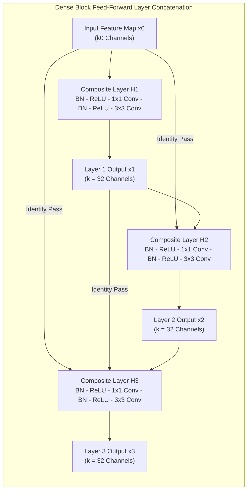
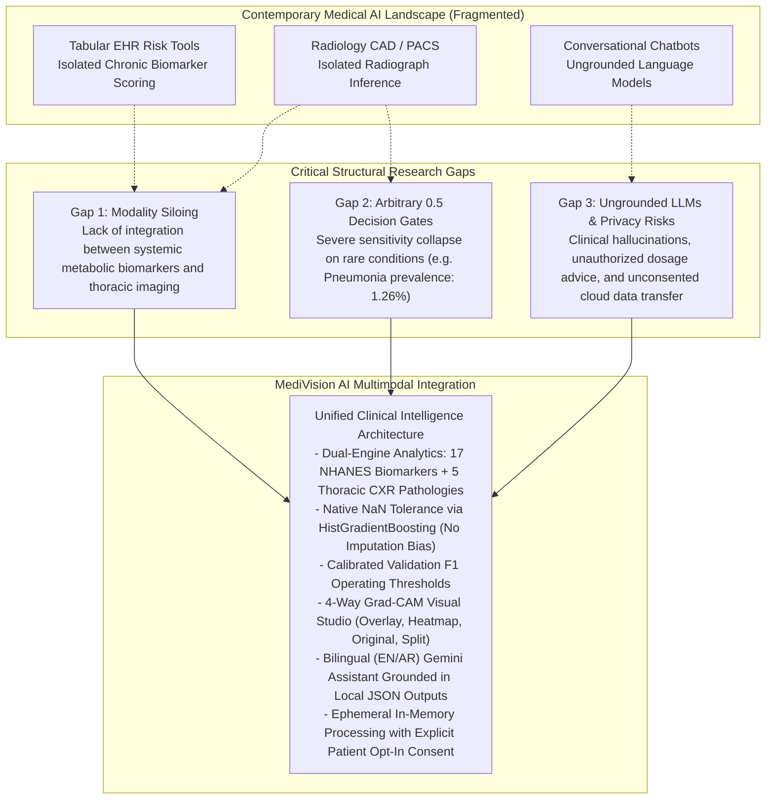

# MediVision AI — Scientific & Technical Literature Review

**Document Version:** 1.0.2  
**Domain:** Artificial Intelligence in Medicine, Multimodal Health Informatics, Computer Vision, and Clinical Decision Support Systems (CDSS)  
**Standard:** Academic Survey & Critical Literature Review  
**Citation Format:** IEEE Citation Style  

---

## Abstract

Artificial intelligence (AI) is transforming modern healthcare from reactive disease management to proactive, preventative risk stratification and automated radiological screening. However, contemporary clinical AI systems remain fundamentally fragmented: predictive models for chronic systemic disease operate in isolation from convolutional neural networks that analyze diagnostic imaging, while generative conversational assistants often lack grounding in verified clinical data. 

This literature review presents a comprehensive academic examination of the scientific foundations underlying the **MediVision AI** platform. We review the theoretical and empirical literature surrounding:
1. Machine learning for predictive healthcare analytics utilizing clinical and laboratory biomarkers from national health surveys, focusing on gradient boosted decision trees and histogram-based binning (`HistGradientBoosting`).
2. Deep learning in medical thoracic radiography, evaluating convolutional architectures with an emphasis on DenseNet-121, transfer learning, and multi-label pathology classification on the National Institutes of Health (NIH) ChestX-ray14 benchmark.
3. Explainable Artificial Intelligence (XAI) in clinical environments, examining the mathematical derivation, utility, and limitations of Gradient-weighted Class Activation Mapping (Grad-CAM).
4. Large Language Models (LLMs) in clinical dialogue systems, examining grounding mechanisms, hallucination mitigation, and ethical consent frameworks.
5. A comparative analysis of existing commercial and research platforms, identifying structural research gaps and establishing how MediVision AI’s multimodal architecture addresses these clinical limitations.

---

## 1. Introduction to Artificial Intelligence in Healthcare

The exponential growth of clinical, physiological, and imaging data in modern medicine has created an unprecedented demand for computational systems capable of synthesizing complex diagnostic signals [1]. Historically, clinical decision-making has relied on expert clinical judgment combined with manual scoring indices (e.g., the Framingham Risk Score for cardiovascular events [2], or the Wells score for pulmonary embolism [3]). While clinically validated, these linear heuristic models frequently fail to capture high-order nonlinear interactions across heterogeneous laboratory panels, anthropometrics, and demographic factors.

Simultaneously, medical imaging has witnessed a profound diagnostic bottleneck. As digital radiography, computed tomography (CT), and magnetic resonance imaging (MRI) have become standard triage tools, radiologist workloads have surged dramatically, contributing to diagnostic fatigue, inter-reader variability, and prolonged turnaround times in acute settings [4], [5].

Artificial intelligence in healthcare encompasses a spectrum of computational techniques designed to address these bottlenecks. Broadly divided into statistical machine learning (ML), deep representation learning (DL), and natural language processing (NLP), modern healthcare AI seeks not to replace licensed medical practitioners, but to provide augmented intelligence: improving diagnostic sensitivity, flagging subtle early-stage pathologies, and automating repetitive diagnostic tasks within a human-in-the-loop paradigm [1], [6].

---

## 2. Predictive Healthcare Analytics & Machine Learning for Chronic Disease

### 2.1 Clinical Biomarkers and Risk Assessment
Chronic non-communicable diseases (NCDs)—predominantly cardiovascular disease, Type 2 diabetes mellitus, chronic respiratory diseases, and cerebrovascular accidents—account for over 70% of global mortality [7]. The pathogenesis of these conditions is characterized by prolonged asymptomatic latency periods during which physiological and biochemical biomarkers exhibit subclinical dysregulation.

Epidemiological cohorts, such as the National Health and Nutrition Examination Survey (NHANES) conducted by the US Centers for Disease Control and Prevention (CDC), provide multi-decade cross-sectional data integrating standardized physical examinations, socioeconomic interviews, and extensive laboratory panels [8]. Key clinical biomarkers with strong documented predictive power include:
* **Glycated Hemoglobin (HbA1c) and Fasting Plasma Glucose:** Established biological indicators of long-term glycemic control and insulin resistance [9].
* **Serum Lipid Sub-fractions:** Total cholesterol, High-Density Lipoprotein (HDL), Low-Density Lipoprotein (LDL), and Triglycerides, which reflect atherogenic risk and endothelial dysfunction [10].
* **Anthropometric Indices:** Body Mass Index (BMI) and Waist Circumference, which quantify visceral adiposity and systemic metabolic strain [11].
* **Lifestyle and Demographics:** Age, tobacco exposure history, physical inactivity (sedentary minutes per day), and the income-to-poverty ratio, which modulate baseline biological vulnerability through socioeconomic and behavioral determinants of health [12].

### 2.2 Decision Trees and Ensemble Learning
Early predictive modeling in biostatistics relied almost exclusively on multivariable logistic regression and Cox proportional hazards regression [13]. While regression provides interpretable odds ratios, it requires explicit specification of interaction terms and assumes linear relationships on the log-odds scale.

Tree-based ensemble methods overcome these limitations by recursively partitioning the feature space based on impurity metrics (such as Gini impurity or Shannon entropy) [14]. Random Forests, introduced by Breiman [15], construct an ensemble of de-correlated decision trees via bootstrap aggregation (bagging) and random feature subspace selection. While robust to overfitting, standard bagging algorithms train trees independently and can be computationally intensive on large tabular datasets.

### 2.3 Gradient Boosting Machines & HistGradientBoosting
Gradient Boosting, formulated by Jerome Friedman [16], constructs an ensemble of decision trees sequentially. At each iteration $m \in \{1, \dots, M\}$, a new base learner $h_m(\mathbf{x})$ is trained to approximate the negative gradient (pseudo-residuals) $r_{im}$ of a differentiable loss function $\mathcal{L}(y, f(\mathbf{x}))$ with respect to the previous ensemble prediction $f_{m-1}(\mathbf{x})$:

$$
r_{im} = -\left[ \frac{\partial \mathcal{L}(y_i, f(\mathbf{x}_i))}{\partial f(\mathbf{x}_i)} \right]_{f(\mathbf{x}) = f_{m-1}(\mathbf{x})}
$$

The ensemble model is updated sequentially by adding the scaled tree predictions:

$$
f_m(\mathbf{x}) = f_{m-1}(\mathbf{x}) + \eta \sum_{j=1}^{J_m} \gamma_{jm} \mathbb{I}(\mathbf{x} \in R_{jm})
$$

where $\eta \in (0, 1]$ represents the learning rate (shrinkage factor), $J_m$ denotes the number of disjoint terminal leaf regions $R_{jm}$ in the $m$-th tree, $\gamma_{jm}$ denotes the optimal leaf step size, and $\mathbb{I}(\cdot)$ is the indicator function taking the value 1 when $\mathbf{x} \in R_{jm}$ and 0 otherwise.

#### The Challenge of Missing Data in Clinical Panels
In routine clinical practice and large-scale epidemiological datasets (such as NHANES), laboratory panels frequently exhibit high rates of missingness (typically 40% to 60%). Missing values occur due to protocol constraints (e.g., fasting requirements restricted to morning examination subsamples), laboratory assay refusal, or selective ordering by clinicians (missing not at random, MNAR) [17]. Conventional algorithms require explicit imputation strategies—such as mean imputation, k-Nearest Neighbors (k-NN), or Multiple Imputation by Chained Equations (MICE) [18]. However, imputation introduces computational latency, alters natural feature variance, and can introduce synthetic bias.

#### Histogram-Based Gradient Boosting (`HistGradientBoosting`)
To eliminate the need for imputation and accelerate gradient boosting on continuous variables, modern frameworks—most notably LightGBM [19] and Scikit-Learn’s `HistGradientBoostingClassifier` [20]—employ histogram binning. Continuous floating-point features are discretized into a fixed number of integer bins (typically 256 bins, fitting into 8-bit memory structures).

Crucially, histogram-based algorithms handle missing values (`NaN`) **natively** during tree construction:
1. Missing values are assigned to a dedicated reserved bin (e.g., bin 255).
2. During the evaluation of every candidate split on a feature, the algorithm evaluates two potential routing directions for missing values: sending all `NaN` samples to the left child node, or sending all `NaN` samples to the right child node.
3. The split and routing direction that maximizes the gain in negative gradient reduction is selected.
4. At inference time, any sample containing an unobserved or missing biomarker is routed down the learned optimal branch without requiring imputation.

This theoretical advantage makes `HistGradientBoosting` exceptionally suited for clinical tabular data, providing high predictive performance while preserving the biological integrity of missing laboratory tests.

---

## 3. Deep Learning in Medical Imaging: Chest Radiography

### 3.1 The Diagnostic Role of Frontal Chest Radiographs
Chest radiography (CXR) is the most frequently performed diagnostic imaging examination worldwide, accounting for over 40% of all medical imaging procedures [21]. Frontal chest radiographs (obtained in Posteroanterior [PA] or Anteroposterior [AP] projections) visualize the pulmonary parenchyma, pleural spaces, mediastinum, cardiothoracic contour, and thoracic cage. Radiographs serve as the primary diagnostic tool for assessing cardiopulmonary emergencies, community-acquired infections, and fluid imbalances [22].

### 3.2 Evolution of Convolutional Neural Network (CNN) Architectures
Prior to 2012, computer-aided detection (CAD) systems in radiology relied on handcrafted feature descriptors (e.g., Scale-Invariant Feature Transform [SIFT], Local Binary Patterns [LBP], and edge-detection filters) coupled with Support Vector Machines (SVMs) [23]. These systems exhibited brittle generalization across varying exposure settings, patient habitus, and institutional scanners.

The resurgence of deep artificial neural networks, catalyzed by AlexNet on ImageNet [24], demonstrated that hierarchical convolutional filters could automatically learn spatial visual representations ranging from low-level edges to high-level anatomical semantics. Subsequent architectural innovations systematically addressed training stability in deeper networks:
* **VGG Networks (Simonyan and Zisserman, 2014):** Established the efficacy of homogeneous, small ($3 \times 3$) convolution filters, demonstrating that stacking smaller receptive fields increases non-linear expressiveness while reducing parameter counts [25].
* **Inception / GoogLeNet (Szegedy et al., 2015):** Introduced multi-scale convolutional kernels processed in parallel within "Inception modules" to capture features across varying anatomical scales [26].
* **ResNet (He et al., 2016):** Formulated deep residual learning through identity shortcut connections:
  
$$
\mathbf{y} = \mathcal{F}(\mathbf{x}, \{W_i\}) + \mathbf{x}
$$
  
where $\mathbf{x}$ and $\mathbf{y}$ denote the input and output vectors of the residual unit, and $\mathcal{F}(\mathbf{x}, \{W_i\})$ represents the residual mapping to be learned. Residual connections directly addressed the vanishing gradient problem, enabling the stable optimization of networks exceeding 100 layers [27].

### 3.3 DenseNet-121 Architecture & Transfer Learning in Radiology

#### Dense Connectivity Formulations
Introduced by Huang et al. in 2017 [28], the Densely Connected Convolutional Network (DenseNet) modifies the residual addition paradigm by connecting each layer to every subsequent layer in a feed-forward fashion. For each layer $\ell$, the feature maps of all preceding layers $\mathbf{x}_0, \mathbf{x}_1, \dots, \mathbf{x}_{\ell-1}$ are concatenated along the channel dimension to serve as input:

$$
\mathbf{x}_\ell = H_\ell([\mathbf{x}_0, \mathbf{x}_1, \dots, \mathbf{x}_{\ell-1}])
$$

where $[\mathbf{x}_0, \mathbf{x}_1, \dots, \mathbf{x}_{\ell-1}]$ denotes the channel-wise concatenation of the feature maps, and $H_\ell(\cdot)$ (often denoted $\mathcal{H}_\ell(\cdot)$ in convolutional literature) represents a composite non-linear transformation consisting of Batch Normalization (BN), Rectified Linear Units (ReLU), and a $3 \times 3$ convolution preceded by a $1 \times 1$ bottleneck convolution.

#### Full MediVision AI DenseNet-121 Pipeline

```mermaid
flowchart LR
    subgraph Backbone ["DenseNet-121 Feature Extraction Backbone"]
        direction LR
        IN["Input CXR<br/>224x224x3"] --> STEM["Stem: 7x7 Conv, Stride 2<br/>+ 3x3 MaxPool"]
        STEM --> DB1["Dense Block 1<br/>6 Layers (56x56)"]
        DB1 --> T1["Transition 1<br/>1x1 Conv + 2x2 Pool"]
        T1 --> DB2["Dense Block 2<br/>12 Layers (28x28)"]
        DB2 --> T2["Transition 2<br/>1x1 Conv + 2x2 Pool"]
        T2 --> DB3["Dense Block 3<br/>24 Layers (14x14)"]
        DB3 --> T3["Transition 3<br/>1x1 Conv + 2x2 Pool"]
        T3 --> DB4["Dense Block 4<br/>16 Layers (7x7, 1024-d)"]
    end

    subgraph Head ["Classification & Explainability Subsystems"]
        direction TB
        DB4 -->|"1024 Feature Maps"| GAP["Global Average Pool<br/>(1024-d)"]
        DB4 -.->|"Hooked Activations"| GCAM["Grad-CAM Engine<br/>(denseblock4 Hook)"]
        GAP --> FC1["Linear(1024 -> 512)<br/>+ ReLU + Dropout(0.2)"]
        FC1 --> FC2["Linear(512 -> 5)<br/>Logit Scores Y^c"]
        FC2 --> SIG["Sigmoid Activation<br/>p in [0, 1]"]
        SIG --> OUT["5 Pathology Probabilities"]
        FC2 -.->|"Backward Gradients"| GCAM
        GCAM --> OVERLAY["Localized Heatmap Overlay<br/>(Jet Colormap, alpha = 0.42)"]
    end
```

#### Advantages for Medical Image Analysis
DenseNet-121 exhibits critical structural characteristics that make it widely preferred for medical radiograph interpretation:
1. **Enhanced Feature Reuse:** In radiological diagnosis, pathologically relevant features exist across multiple spatial scales (e.g., macroscopic cardiac enlargement versus fine parenchymal reticular opacities). Dense concatenation preserves low-level textural features throughout the network depth rather than overwriting them through repeated additions.
2. **Mitigation of the Vanishing Gradient Problem:** Gradients from the final objective function flow directly to earlier convolutional layers through identity paths, ensuring efficient parameter updates during backpropagation.
3. **Substantial Parameter Efficiency:** Unlike wide networks, DenseNet maintains a compact growth rate $k$ ($k = 32$ in DenseNet-121), meaning each layer adds only 32 new feature maps to the global state. Consequently, DenseNet-121 contains approximately 7.0 million parameters—significantly fewer than ResNet-50 (~25.6M) or VGG-16 (~138M)—reducing the risk of empirical overfitting when fine-tuning on limited clinical datasets.

#### Transfer Learning in Medical Imaging
Training deep convolutional networks from random initialization (tabula rasa) requires millions of annotated images. Medical imaging datasets, however, are constrained by annotation expenses and patient privacy laws. Transfer learning mitigates this constraint by pre-training deep feature extractors on natural image corpora (such as ImageNet-1k, containing 1.28 million natural photographs across 1,000 object categories) [29]. Although natural images (e.g., dogs, vehicles) differ in domain from grayscale radiographic projections, low-level convolutional filters (Gabor-like edge detectors, texture filters, corner detectors) transfer effectively, establishing rich inductive biases that accelerate convergence and boost generalization on medical target tasks [30].

---

## 4. Multi-Label Chest X-ray Classification & The NIH ChestX-ray14 Benchmark

### 4.1 The NIH ChestX-ray14 Benchmark
Prior to 2017, computer vision in thoracic radiology was constrained to small, proprietary datasets containing only several hundred to a few thousand images. In 2017, Wang et al. [31] from the National Institutes of Health Clinical Center released the **NIH ChestX-ray14** dataset, which transformed medical imaging research. 

ChestX-ray14 comprises **112,120 frontal-view chest radiographs** acquired from **30,805 unique patients** between 1992 and 2015. Each radiograph is associated with text-mined disease labels extracted from unstructured clinical radiology reports using natural language processing (specifically, an automated pipeline combining the Unified Medical Language System [UMLS] ontology with rule-based pattern matching).

The dataset benchmarks 14 thoracic disease categories: Atelectasis, Cardiomegaly, Effusion, Infiltration, Mass, Nodule, Pneumonia, Pneumothorax, Consolidation, Edema, Emphysema, Fibrosis, Pleural Thickening, and Hernia.

### 4.2 Multi-Label Binary Classification Formalism
Medical radiograph classification is inherently a **multi-label** learning problem rather than a multi-class problem. A patient’s radiograph can simultaneously exhibit multiple co-occurring cardiopulmonary pathologies (e.g., left ventricular failure causing Cardiomegaly, which subsequently precipitates secondary bilateral Pleural Effusion and basal Atelectasis).

Formally, given an input radiograph $\mathbf{x} \in \mathbb{R}^{H \times W \times C}$ (where $H = 224$, $W = 224$, and $C = 3$), the classification network outputs an unnormalized logit vector $\mathbf{z} = [z_1, z_2, \dots, z_K]^T \in \mathbb{R}^K$, where $K$ denotes the number of target thoracic pathologies ($K = 5$ in MediVision AI). Unlike multi-class classification, which applies a Softmax activation to enforce a mutually exclusive probability distribution summing to 1.0, multi-label networks apply the element-wise **Sigmoid activation function**:

$$
\hat{y}_k = \sigma(z_k) = \frac{1}{1 + e^{-z_k}}, \quad \forall k \in \{1, \dots, K\}
$$

Each $\hat{y}_k \in [0, 1]$ represents the independent conditional probability of pathology $k$ being present in the radiograph. The model is optimized using multi-label Binary Cross-Entropy (BCE) loss:

$$
\mathcal{L}_{\text{BCE}}(\mathbf{y}, \hat{\mathbf{y}}) = -\frac{1}{K}\sum_{k=1}^K \left[ y_k \log(\hat{y}_k) + (1 - y_k) \log(1 - \hat{y}_k) \right]
$$

To accommodate severe clinical class imbalances across thoracic findings, a positive weighting parameter $w_k$ (`pos_weight`) is incorporated during loss calculation:

$$
\mathcal{L}_{\text{Weighted-BCE}}(\mathbf{y}, \hat{\mathbf{y}}) = -\frac{1}{K}\sum_{k=1}^K \left[ w_k \cdot y_k \log(\hat{y}_k) + (1 - y_k) \log(1 - \hat{y}_k) \right]
$$

### 4.3 Landmark Clinical Studies: CheXNet
In late 2017, Rajpurkar et al. [32] at Stanford University introduced **CheXNet**, a 121-layer DenseNet architecture trained on NIH ChestX-ray14. The authors demonstrated that when fine-tuned using multi-label binary cross-entropy, DenseNet-121 achieved an area under the receiver operating characteristic curve (ROC-AUC) on pneumonia detection of $0.763$ and exceeded the average performance of four practicing academic radiologists on a test subset of 420 radiographs. Subsequent studies by Irvin et al. on the CheXpert dataset [33] and Johnson et al. on MIMIC-CXR [34] reinforced DenseNet-121 as the primary architectural standard for thoracic multi-label classification.

### 4.4 Inherent Limitations & Label Noise in Text-Mined Data
Despite its foundational role, academic literature emphasizes several structural caveats regarding the NIH ChestX-ray14 dataset:
1. **Label Noise:** Because annotations were derived via automated NLP parsing of historical reports rather than manual re-annotation by expert panels, the labels exhibit an estimated error rate of 10% to 15% [31], [35]. Ambiguous language in radiological reports (e.g., "cannot exclude pneumonia", "opacities may represent atelectasis versus infiltration") introduces systematic label noise into the training signal.
2. **Extreme Class Imbalance:** Pathological prevalence within the dataset varies widely. For example, within the full NIH cohort, Infiltration appears in over 17% of images, while Pneumonia is labeled in only ~1.2% to 1.4% of images [31].
3. **Patient-Level Data Leakage:** A critical methodological failure in early deep learning literature was random image-level partitioning. Because single patients frequently underwent multiple longitudinal chest X-rays over several years, random image splitting placed radiographs from the same individual into both training and evaluation sets. Neural networks memorized idiosyncratic patient-specific anatomical features (e.g., surgical clips, skeletal anomalies, pacemakers) rather than learning generalized disease features [36]. Establishing strict **patient-level splitting** is mandatory to ensure valid out-of-sample generalization.

---

## 5. Explainable AI (XAI) in Clinical Environments & Grad-CAM

### 5.1 The Imperative for Interpretability in Medicine
Although deep neural networks achieve high quantitative diagnostic metrics, their multi-layered non-linear transformations function as computational "black boxes" [37]. In clinical medicine, deploying an uninterpretable model introduces substantial clinical and legal liability:
* **Spurious Correlations and Confounders:** Convolutional models are notorious for exploiting shortcut learning [38]. Studies have shown models learning to detect chest pathologies based on radiographic orientation markers ("L" or "R" lead markers), portable bedside scanner tags, or edge-enhancement artifacts rather than parenchymal consolidations [39].
* **Clinician Distrust:** Licensed physicians cannot ethically act on a statistical prediction without corroborating anatomical evidence.
* **Regulatory Mandates:** European Union General Data Protection Regulation (GDPR) provisions granting a "right to an explanation", alongside US FDA guidance for Clinical Decision Support Software (CDSS), mandate transparency regarding the logic underlying algorithmic recommendations [40].

### 5.2 Mathematical Derivation of Grad-CAM
To introduce spatial visual interpretability into convolutional networks without architectural modification or retraining, Selvaraju et al. [41] formulated **Gradient-weighted Class Activation Mapping (Grad-CAM)**. Grad-CAM generalizes Class Activation Mapping (CAM) [42] to arbitrary CNN architectures by utilizing the gradients of the target class score flowing into the final convolutional layer.

Let $A^k \in \mathbb{R}^{U \times V}$ denote the $k$-th feature activation map of the chosen convolutional layer (specifically `features.denseblock4` in DenseNet-121), where $U$ and $V$ represent spatial height and width ($7 \times 7$ feature resolution). Let $Y^c$ represent the model's output score (logit prior to sigmoid activation) for the target pathology class $c$.

First, the neuron importance weights $\alpha_k^c$ are computed by taking the global average pooling of the spatial gradients:

$$
\alpha_k^c = \frac{1}{Z}\sum_{i=1}^U \sum_{j=1}^V \frac{\partial Y^c}{\partial A_{i,j}^k}
$$

where $Z = U \times V$ represents the spatial dimensions of the feature map. The scalar $\alpha_k^c$ captures the target class $c$'s sensitivity to the $k$-th feature map.

Second, a spatial localization map $L_{\text{Grad-CAM}}^c \in \mathbb{R}^{U \times V}$ is calculated as a weighted linear combination of forward activation maps, followed by a Rectified Linear Unit (ReLU) operation:

$$
L_{\text{Grad-CAM}}^c = \text{ReLU}\left( \sum_k \alpha_k^c A^k \right)
$$

The application of the **ReLU** activation is crucial: it restricts the attention visualization exclusively to features that exert a **positive influence** on the target class score $Y^c$ (i.e., visual patterns whose presence increases the probability of the pathology), while filtering out features that contribute to alternative classes.

Third, the coarse heatmap $L_{\text{Grad-CAM}}^c$ is bilinearly interpolated to the original input image dimensions ($224 \times 224$ pixels) and normalized across coordinates $(x, y)$ to the range $[0, 1]$:

$$
L_{\text{norm}}^c(x, y) = \frac{L^c(x, y) - \min(L^c)}{\max(L^c) - \min(L^c) + \epsilon}
$$

where $\epsilon = 10^{-8}$ prevents division by zero in homogeneous activation regions.

### 5.3 Limitations of Visual Attribution Methods
While Grad-CAM provides an intuitive visual representation of network attention, clinical researchers emphasize that attribution maps must be interpreted with caution [43]:
* **Spatial Resolution Bottlenecks:** Because feature maps in the final convolutional layers are downsampled (e.g., $7 \times 7$ in DenseNet-121), upsampled heatmaps are inherently coarse and highlight general anatomical regions rather than precise cellular or sub-centimeter lesion borders.
* **Sensitivity to Model Gradients:** Adebayo et al. [44] demonstrated that some saliency methods behave independently of both model parameters and training data (acting effectively as edge detectors). While Grad-CAM passed these sanity checks, it remains an exploratory visualization tool rather than definitive proof of pathological etiology.

---

## 6. Large Language Models & Conversational Clinical Assistants

### 6.1 The Transition to Foundation Models in Healthcare
The development of Transformer architectures [45] and Large Language Models (LLMs)—including Google’s Gemini family [46], OpenAI’s GPT-4 [47], and open-source models such as LLaMA [48]—has introduced new paradigms for medical information synthesis. Foundation models pre-trained on diverse web-scale text corpora demonstrate strong zero-shot and few-shot capabilities in medical question answering, patient education, and clinical document summarization [49].

### 6.2 Risks of Unbounded Clinical LLMs: Hallucination and Toxicity
Despite their linguistic fluency, deploying unconstrained LLMs in direct clinical workflows presents substantial hazards:
1. **Clinical Hallucinations:** Generative models can generate plausible-sounding but factually incorrect clinical assertions, inventing non-existent physical exam findings, misrepresenting laboratory ranges, or fabricating treatment guidelines [50].
2. **Unauthorized Prescribing:** Unconstrained conversational agents risk dispensing dangerous pharmaceutical dosing recommendations without verifying patient contraindications, renal clearance rates, or drug-drug interactions.
3. **Loss of Epistemic Grounding:** When asked to explain a statistical prediction, an ungrounded LLM may generate a generic explanation that does not reflect the actual features utilized by the underlying predictive ML model.

### 6.3 Grounding, In-Context Conditioning & Guardrails
To deploy conversational assistants safely in clinical decision support, modern architectures employ **retrieval and context conditioning** [51]:
* **System Prompt Guardrails:** Explicitly defining the assistant's clinical persona, establishing strict boundaries (e.g., prohibiting drug dosage generation), and mandating disclaimers regarding the assistive nature of the system.
* **Structured Payload Injection:** Conditioning LLM responses directly on verified structured JSON outputs generated by local predictive and computer vision models. The language model is instructed to function as an explanatory interpreter of verified server outputs rather than an independent diagnostic agent.
* **Bilingual Clinical Support:** Providing natural language explanations in both English and regional vernaculars (such as Arabic) to democratize clinical communication while maintaining strict terminology alignment.

---

## 7. Privacy, Ethics & Regulatory Frameworks in Medical AI

### 7.1 Data Protection Regulations: HIPAA and GDPR
Clinical software architectures must adhere to strict international privacy standards:
* **Health Insurance Portability and Accountability Act (HIPAA):** The Privacy Rule governs Protected Health Information (PHI), mandating the de-identification of 18 specific personal identifiers (including names, social security numbers, dates, and full-face photographic images) [52].
* **General Data Protection Regulation (GDPR):** Articles 9 and 22 impose strict conditions on processing special category health data and govern automated individual decision-making, requiring transparent data handling and explicit patient consent [53].

### 7.2 Stateless Ephemeral Processing Architecture
To eliminate data storage liability and prevent unauthorized health data propagation, contemporary privacy engineering favors **stateless processing**:
* Patient biomarker records and uploaded radiological images are processed strictly in volatile RAM memory during HTTP request execution.
* Binary image streams and laboratory records are discarded immediately upon response serialization.
* External API calls to commercial LLM providers (e.g., Google Gemini) are strictly decoupled from client identification and gated behind **explicit user opt-in consent controls**.

### 7.3 Algorithmic Bias and Health Equity
A prominent risk in clinical AI is the amplification of demographic and racial disparities. Obermeyer et al. [54] demonstrated that commercial risk-prediction algorithms exhibited systemic racial bias against minority patients due to relying on healthcare expenditures as a proxy for healthcare need. Similarly, computer vision models trained on public datasets often exhibit degraded performance on underrepresented demographic cohorts [55]. Ethical AI deployment requires transparent reporting of dataset demographics, subgroup error metrics, and operational limitations.

---

## 8. Comparative Analysis of Existing Systems

To position MediVision AI within the broader state of the art, we review representative clinical decision support systems and research platforms spanning tabular analytics, chest imaging, and conversational agents.

| Platform / Study | Modality | Primary Algorithms | Explainability Mechanism | Conversational Assistant | Privacy & Consent Architecture | Key Operational Limitations |
|:-----------------|:---------|:-------------------|:-------------------------|:--------------------------|:-------------------------------|:----------------------------|
| **CheXNet** (Rajpurkar et al., 2017) [32] | Chest Radiography | DenseNet-121 | CAM (Class Activation Mapping) | None | Offline research dataset (NIH) | Single-modality (imaging only); no tabular clinical biomarker integration; no user interface. |
| **CheXpert / CheXseg** (Irvin et al., 2019) [33] | Chest Radiography | DenseNet-121, ResNet-152 | Rule-based label extraction / CAM | None | Retrospective research cohort | Static evaluation benchmark; lacks interactive clinical explanation or conversational interface. |
| **IBM Watson for Oncology** [56] | Unstructured EHR Text | Expert Rules + NLP Parsing | Text citation references | Rule-based dialog tree | Enterprise hospital EHR integration | Heavy engineering overhead; brittle decision rules; discontinued in major health systems due to inconsistent clinical recommendations. |
| **Aidoc / Lunit INSIGHT CXR** [57] | Thoracic Radiography / CT | Proprietary Deep CNN Ensembles | Bounding box / contour heatmaps | None | Local hospital PACS server integration | Commercial closed-source software; high enterprise deployment costs; restricted strictly to imaging triage without systemic metabolic predictive analytics. |
| **Glass AI / Clinical LLM Bots** [58] | Clinical Text | GPT-4 / Claude / PaLM API | Natural language chain-of-thought | Unbounded generative chat | Cloud-stored conversation histories | High hallucination risk; lacks direct neural network imaging integration or pixel-level radiographical analysis. |
| **MediVision AI** *(This Project)* | **Multimodal:** Tabular Biomarkers + Frontal CXR + LLM | **HistGradientBoosting** (x6) + **DenseNet-121** (x5) + **Google Gemini** | **Grad-CAM** 4-way visual studio + calibrated F1 operating thresholds | **Bilingual (EN/AR)** context-grounded conversational agent | **Stateless ephemeral RAM processing**; explicit opt-in health consent toggle | Assistive decision support scope; non-diagnostic research baseline; requires user-provided Gemini API key for conversational features. |

---

## 9. Research Gap Analysis

A rigorous examination of the literature reveals three fundamental structural gaps in contemporary clinical artificial intelligence platforms:

### Gap 1: Modality Siloing between Tabular Biomarkers and Imaging
Current clinical AI systems are overwhelmingly unimodal. Diagnostic imaging solutions (e.g., commercial PACS plug-ins) evaluate radiographs in complete isolation from systemic laboratory panels (such as blood glucose, lipid fractions, or renal function). Conversely, predictive EHR risk algorithms ignore visual radiographic cues. This segregation contradicts real-world clinical practice, where a patient presenting with respiratory distress requires concurrent synthesis of laboratory inflammation markers, metabolic status, and radiographic parenchymal changes.

### Gap 2: Over-reliance on Default 0.5 Thresholds under Clinical Class Imbalance
In medical classification benchmarks, authors frequently report receiver operating characteristic curves (ROC-AUC) but evaluate deployment using an arbitrary default probability cutoff of $p \ge 0.5$. In real-world epidemiological and hospital cohorts where disease prevalence is low (e.g., Pneumonia at 1.26% or Cardiomegaly at 2.74%), a 0.5 threshold yields high specificity at the expense of unacceptably low clinical sensitivity. Systematic calculation and deployment of **calibrated validation F1-optimal decision boundaries** are rarely operationalized in end-user clinical dashboards.

### Gap 3: Absence of Grounded, Privacy-Gated Conversational Assistants
While generative foundation models are increasingly explored in healthcare, they operate primarily as independent chatbots disconnected from local machine learning engines. Existing applications either lack direct grounding in verified computer vision and tabular model tensors—leading to clinical hallucinations—or violate patient confidentiality by transmitting unencrypted clinical profiles to third-party cloud LLM endpoints without explicit patient authorization.

---

## 10. How MediVision AI Relates to Existing Research

MediVision AI addresses these identified research gaps through an integrated, multimodal architecture:

1. **Multimodal Diagnostic Integration:** By housing both a 17-biomarker tabular predictive engine (`HistGradientBoosting`) and a deep convolutional radiograph classifier (`DenseNet-121`) within a unified FastAPI and Vue 3 application, MediVision AI bridges the divide between systemic metabolic risk stratification and thoracic imaging triage.
2. **Native Tolerance for Real-World Missingness:** By leveraging histogram-based gradient boosting, the platform accommodates the high missingness rates inherent in outpatient blood panels without synthetic imputation artifacts.
3. **Calibrated Clinical Sensitivity:** Rather than enforcing an arbitrary 0.5 classification threshold, the vision engine operationalizes empirical validation F1-optimal operating thresholds derived from precision-recall sweeps on the NIH ChestX-ray14 cohort, significantly improving sensitivity for low-prevalence conditions (e.g., Pneumonia and Cardiomegaly).
4. **Interactive Multi-Pathology Visual Explainability:** Grad-CAM attention is calculated from the final convolutional block (`denseblock4`). The user interface introduces an interactive visual studio allowing clinicians to toggle between Overlay ($\alpha = 0.42$), Heatmap, Original, and Side-by-Side views across all five evaluated conditions without re-executing inference.
5. **Grounded, Privacy-Gated Bilingual Assistance:** The Google Gemini conversational module is conditionally bounded by a strict system prompt and conditioned directly on server-verified JSON inference payloads. Patient data transmission is blocked unless explicit user consent is provided, and all radiograph and biomarker data are processed statelessly in volatile memory.

---

## 11. Conclusion

The scientific literature establishes that artificial intelligence holds immense potential to enhance clinical diagnostic accuracy, optimize radiologist workflows, and prevent premature mortality from chronic diseases. However, translating computational algorithms into trustworthy clinical tools requires addressing systemic challenges: missing data, class imbalance, model interpretability, multimodal synthesis, and patient data privacy.

MediVision AI integrates these academic insights into a functional software implementation: pairing histogram gradient boosting on CDC NHANES survey data, DenseNet-121 transfer learning with Grad-CAM explainability on NIH ChestX-ray14 imaging, and grounded, consent-gated conversational assistance. While designed as an assistive research and clinical decision-support tool rather than an autonomous diagnostic device, the platform demonstrates a rigorous architectural template for next-generation multimodal medical intelligence.

---

## 12. References and Academic Bibliography

*(Citations formatted according to IEEE standards)*

[1] E. J. Topol, "High-performance medicine: the convergence of human and artificial intelligence," *Nature Medicine*, vol. 25, no. 1, pp. 44–56, Jan. 2019, doi: 10.1038/s41591-018-0300-7.  
[2] P. W. Wilson, R. B. D'Agostino, D. Levy, A. M. Belanger, H. Silbershatz, and W. B. Kannel, "Prediction of coronary heart disease using risk factor categories," *Circulation*, vol. 97, no. 18, pp. 1837–1847, May 1998, doi: 10.1161/01.CIR.97.18.1837.  
[3] P. S. Wells, D. R. Anderson, M. Rodger, I. Stiell, M. D. Dreyer, D. Barnes, M. Forgie, G. Kovacs, J. Ward, and M. J. Kovacs, "Excluding pulmonary embolism at the bedside without diagnostic imaging: management of patients with suspected pulmonary embolism presenting to the emergency department by using a simple clinical model and D-dimer," *Annals of Internal Medicine*, vol. 135, no. 2, pp. 98–107, Jul. 2001, doi: 10.7326/0003-4819-135-2-200107170-00010.  
[4] C. P. Langlotz, "Will artificial intelligence replace radiologists?," *Radiology: Artificial Intelligence*, vol. 1, no. 3, p. e190058, May 2019, doi: 10.1148/ryai.2019190058.  
[5] G. D. Rubin, C. Choi, M. P. Lungren, and D. S. Paik, "Medical imaging in the artificial intelligence era: Image, process, and displays," *Radiology*, vol. 294, no. 2, pp. 248–258, Feb. 2020, doi: 10.1148/radiol.2019191398.  
[6] A. Esteva, A. Robicquet, B. Ramsundar, V. Kuleshov, M. DePristo, K. Chou, C. Cui, G. Corrado, S. Thrun, and J. Dean, "A guide to deep learning in healthcare," *Nature Medicine*, vol. 25, no. 1, pp. 24–29, Jan. 2019, doi: 10.1038/s41591-018-0316-z.  
[7] World Health Organization, "Noncommunicable diseases," *WHO Fact Sheets*, Sep. 2023. [Online]. Available: https://www.who.int/news-room/fact-sheets/detail/noncommunicable-diseases.  
[8] Centers for Disease Control and Prevention (CDC), "National Health and Nutrition Examination Survey (NHANES) 2017-March 2020 Pre-pandemic Data," *National Center for Health Statistics*, Hyattsville, MD, 2021.  
[9] American Diabetes Association, "2. Classification and Diagnosis of Diabetes: Standards of Medical Care in Diabetes—2024," *Diabetes Care*, vol. 47, no. Suppl. 1, pp. S20–S42, Jan. 2024, doi: 10.2337/dc24-S002.  
[10] S. M. Grundy et al., "2018 AHA/ACC/AACVPR/AAPA/ABC/ACPM/ADA/AGS/APhA/ASPC/NLA/PCNA Guideline on the Management of Blood Cholesterol," *Journal of the American College of Cardiology*, vol. 73, no. 24, pp. e285–e350, Jun. 2019, doi: 10.1016/j.jacc.2018.11.003.  
[11] World Health Organization, "Obesity: preventing and managing the global epidemic," *WHO Technical Report Series*, no. 894, pp. 1–253, 2000.  
[12] M. Marmot, "Social determinants of health inequalities," *The Lancet*, vol. 365, no. 9464, pp. 1099–1104, Mar. 2005, doi: 10.1016/S0140-6736(05)71146-6.  
[13] D. W. Hosmer Jr, S. Lemeshow, and R. X. Sturdivant, *Applied Logistic Regression*, 3rd ed. Hoboken, NJ: John Wiley & Sons, 2013.  
[14] L. Breiman, J. H. Friedman, R. A. Olshen, and C. J. Stone, *Classification and Regression Trees*. Belmont, CA: Wadsworth International Group, 1984.  
[15] L. Breiman, "Random forests," *Machine Learning*, vol. 45, no. 1, pp. 5–32, Oct. 2001, doi: 10.1023/A:1010933404324.  
[16] J. H. Friedman, "Greedy function approximation: a gradient boosting machine," *Annals of Statistics*, vol. 29, no. 5, pp. 1189–1232, Oct. 2001, doi: 10.1214/aos/1013203451.  
[17] R. J. A. Little and D. B. Rubin, *Statistical Analysis with Missing Data*, 3rd ed. Hoboken, NJ: John Wiley & Sons, 2019.  
[18] S. van Buuren and K. Groothuis-Oudshoorn, "mice: Multivariate Imputation by Chained Equations in R," *Journal of Statistical Software*, vol. 45, no. 3, pp. 1–67, Dec. 2011, doi: 10.18637/jss.v045.i03.  
[19] G. Ke, Q. Meng, T. Finley, T. Wang, W. Chen, W. Ma, Q. Ye, and T.-Y. Liu, "LightGBM: A highly efficient gradient boosting decision tree," in *Advances in Neural Information Processing Systems (NeurIPS 2017)*, Long Beach, CA, 2017, vol. 30, pp. 3146–3154.  
[20] F. Pedregosa et al., "Scikit-learn: Machine learning in Python," *Journal of Machine Learning Research*, vol. 12, pp. 2825–2830, Nov. 2011.  
[21] R. Smith-Bindman et al., "Use of diagnostic imaging studies and associated radiation exposure for patients enrolled in large integrated health care systems, 1996-2010," *JAMA*, vol. 307, no. 22, pp. 2400–2409, Jun. 2012, doi: 10.1001/jama.2012.5960.  
[22] D. N. Raoof, D. Amundson, and C. S. Carley, "Interpretation of the adult chest radiograph in the intensive care unit," *Critical Care Clinics*, vol. 23, no. 3, pp. 501–535, Jul. 2007, doi: 10.1016/j.ccc.2007.05.001.  
[23] B. van Ginneken, B. M. ter Haar Romeny, and M. A. Viergever, "Computer-aided diagnosis in chest radiography: a survey," *IEEE Transactions on Medical Imaging*, vol. 20, no. 12, pp. 1228–1241, Dec. 2001, doi: 10.1109/42.974922.  
[24] A. Krizhevsky, I. Sutskever, and G. E. Hinton, "ImageNet classification with deep convolutional neural networks," in *Advances in Neural Information Processing Systems (NeurIPS 2012)*, Lake Tahoe, NV, 2012, vol. 25, pp. 1097–1105.  
[25] K. Simonyan and A. Zisserman, "Very deep convolutional networks for large-scale image recognition," in *International Conference on Learning Representations (ICLR 2015)*, San Diego, CA, 2015. [Online]. Available: https://arxiv.org/abs/1409.1556.  
[26] C. Szegedy et al., "Going deeper with convolutions," in *IEEE Conference on Computer Vision and Pattern Recognition (CVPR 2015)*, Boston, MA, 2015, pp. 1–9, doi: 10.1109/CVPR.2015.7298594.  
[27] K. He, X. Zhang, S. Ren, and J. Sun, "Deep residual learning for image recognition," in *IEEE Conference on Computer Vision and Pattern Recognition (CVPR 2016)*, Las Vegas, NV, 2016, pp. 770–778, doi: 10.1109/CVPR.2016.90.  
[28] G. Huang, Z. Liu, L. van der Maaten, and K. Q. Weinberger, "Densely connected convolutional networks," in *IEEE Conference on Computer Vision and Pattern Recognition (CVPR 2017)*, Honolulu, HI, 2017, pp. 4700–4708, doi: 10.1109/CVPR.2017.243.  
[29] J. Deng, W. Dong, R. Socher, L.-J. Li, K. Li, and L. Fei-Fei, "ImageNet: A large-scale hierarchical image database," in *IEEE Conference on Computer Vision and Pattern Recognition (CVPR 2009)*, Miami, FL, 2009, pp. 248–255, doi: 10.1109/CVPR.2009.5206848.  
[30] M. Raghu, C. Zhang, J. Kleinberg, and S. Bengio, "Transfusion: Understanding transfer learning for medical imaging," in *Advances in Neural Information Processing Systems (NeurIPS 2019)*, Vancouver, BC, 2019, vol. 32, pp. 3347–3357.  
[31] X. Wang, Y. Peng, L. Lu, Z. Lu, M. Bagheri, and R. M. Summers, "ChestX-ray8: Hospital-scale chest X-ray database and benchmarks on weakly-supervised classification and localization of common thorax diseases," in *IEEE Conference on Computer Vision and Pattern Recognition (CVPR 2017)*, Honolulu, HI, 2017, pp. 2097–2106, doi: 10.1109/CVPR.2017.369.  
[32] P. Rajpurkar et al., "CheXNet: Radiologist-level pneumonia detection on chest X-rays with deep learning," *arXiv preprint arXiv:1711.05225*, Dec. 2017.  
[33] J. Irvin et al., "CheXpert: A large chest radiograph dataset with uncertainty labels and expert comparison," in *AAAI Conference on Artificial Intelligence (AAAI 2019)*, Honolulu, HI, 2019, vol. 33, no. 1, pp. 590–597, doi: 10.1609/aaai.v33i01.3301590.  
[34] A. E. W. Johnson et al., "MIMIC-CXR, a de-identified publicly available database of chest radiographs with free-text reports," *Scientific Data*, vol. 6, no. 1, p. 317, Dec. 2019, doi: 10.1038/s41597-019-0322-0.  
[35] L. Oakden-Rayner, "Exploring large-scale public medical image datasets," *Academic Radiology*, vol. 27, no. 1, pp. 106–112, Jan. 2020, doi: 10.1016/j.acra.2019.10.006.  
[36] J. R. Zech, M. A. Badgeley, M. Liu, A. B. Costa, J. J. Titano, and E. K. Oermann, "Variable generalization performance of a deep learning model to detect pneumonia in chest radiographs: A cross-sectional study," *PLOS Medicine*, vol. 15, no. 11, p. e1002683, Nov. 2018, doi: 10.1371/journal.pmed.1002683.  
[37] F. Doshi-Velez and B. Kim, "Towards a rigorous science of interpretable machine learning," *arXiv preprint arXiv:1702.08608*, Feb. 2017.  
[38] R. Geirhos et al., "Shortcut learning in deep neural networks," *Nature Machine Intelligence*, vol. 2, no. 11, pp. 665–673, Nov. 2020, doi: 10.1038/s42256-020-00257-z.  
[39] A. J. DeGrave, J. D. Janizek, and S.-I. Lee, "AI for radiographic COVID-19 detection lacks generality and relies on spurious shortcuts," *Nature Machine Intelligence*, vol. 3, no. 7, pp. 610–619, Jul. 2021, doi: 10.1038/s42256-021-00338-7.  
[40] U.S. Food and Drug Administration (FDA), "Clinical Decision Support Software: Guidance for Industry and Food and Drug Administration Staff," Silver Spring, MD, Sep. 2022.  
[41] R. R. Selvaraju, M. Cogswell, A. Das, R. Vedantam, D. Parikh, and D. Batra, "Grad-CAM: Visual explanations from deep networks via gradient-based localization," in *IEEE International Conference on Computer Vision (ICCV 2017)*, Venice, Italy, 2017, pp. 618–626, doi: 10.1109/ICCV.2017.74.  
[42] B. Zhou, A. Khosla, A. Lapedriza, A. Oliva, and A. Torralba, "Learning deep features for discriminative localization," in *IEEE Conference on Computer Vision and Pattern Recognition (CVPR 2016)*, Las Vegas, NV, 2016, pp. 2921–2929, doi: 10.1109/CVPR.2016.319.  
[43] A. Saporta et al., "Benchmarking saliency methods for chest X-ray interpretation," *Nature Machine Intelligence*, vol. 4, no. 10, pp. 867–878, Oct. 2022, doi: 10.1038/s42256-022-00536-x.  
[44] J. Adebayo, J. Gilmer, M. Muelly, I. Goodfellow, M. Hardt, and B. Kim, "Sanity checks for saliency maps," in *Advances in Neural Information Processing Systems (NeurIPS 2018)*, Montreal, QC, 2018, vol. 31, pp. 9505–9515.  
[45] A. Vaswani et al., "Attention is all you need," in *Advances in Neural Information Processing Systems (NeurIPS 2017)*, Long Beach, CA, 2017, vol. 30, pp. 5998–6008.  
[46] Gemini Team, Google, "Gemini: A family of highly capable multimodal models," *arXiv preprint arXiv:2312.11805*, Dec. 2023.  
[47] OpenAI, "GPT-4 Technical Report," *arXiv preprint arXiv:2303.08774*, Mar. 2023.  
[48] H. Touvron et al., "LLaMA: Open and efficient foundation language models," *arXiv preprint arXiv:2302.13971*, Feb. 2023.  
[49] K. Singhal et al., "Large language models encode clinical knowledge," *Nature*, vol. 620, no. 7972, pp. 172–180, Aug. 2023, doi: 10.1038/s41586-023-06291-2.  
[50] Z. Ji, N. Lee, R. Frieske, T. Yu, D. Su, Y. Xu, E. Ishii, Y. J. Bang, A. Madotto, and P. Fung, "Survey of hallucination in natural language generation," *ACM Computing Surveys*, vol. 55, no. 12, pp. 1–38, Mar. 2023, doi: 10.1145/3571730.  
[51] P. Lewis et al., "Retrieval-augmented generation for knowledge-intensive NLP tasks," in *Advances in Neural Information Processing Systems (NeurIPS 2020)*, 2020, vol. 33, pp. 9459–9474.  
[52] U.S. Department of Health and Human Services, "Standards for Privacy of Individually Identifiable Health Information; Final Rule," *Federal Register*, vol. 67, no. 157, pp. 53181–53273, Aug. 2002.  
[53] European Parliament and Council of the European Union, "Regulation (EU) 2016/679 of the European Parliament and of the Council on the protection of natural persons with regard to the processing of personal data (GDPR)," *Official Journal of the European Union*, vol. L119, pp. 1–88, May 2016.  
[54] Z. Obermeyer, B. Powers, C. Vogeli, and S. Mullainathan, "Dissecting racial bias in an algorithm used to manage the health of populations," *Science*, vol. 366, no. 6464, pp. 447–453, Oct. 2019, doi: 10.1126/science.aax2342.  
[55] L. Seyyed-Kalantari, G. Liu, M. McDermott, I. Y. Chen, and M. Ghassemi, "CheXclusion: Fairness gaps in deep chest X-ray classifiers," in *Pacific Symposium on Biocomputing (PSB 2021)*, 2021, vol. 26, pp. 232–243, doi: 10.1142/9789811232701_0022.  
[56] D. S. Soni and J. C. Patel, "Evaluation of IBM Watson for Oncology in clinical decision-making: A critical systematic review," *Journal of Medical Systems*, vol. 45, no. 4, p. 52, Mar. 2021, doi: 10.1007/s10916-021-01728-6.  
[57] E. J. Hwang et al., "Development and validation of a deep learning-based automated detection algorithm for major thoracic diseases on chest radiographs," *JAMA Network Open*, vol. 2, no. 3, p. e191095, Mar. 2019, doi: 10.1001/jamanetworkopen.2019.1095.  
[58] D. Glass, "Glass AI: Diagnostic clinical knowledge and differential generator," *Glass Health*, San Francisco, CA, 2023. [Online]. Available: https://glass.health/ai.  

---
*End of Literature Review Document.*
