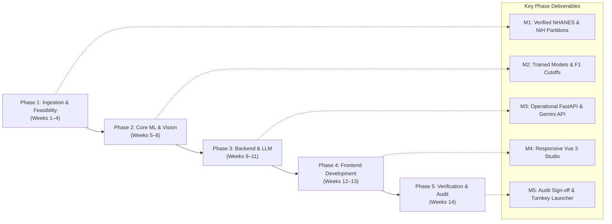
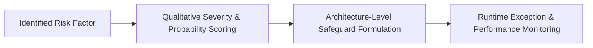
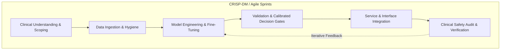

# MediVision AI — Project Planning & Management

**Document Version:** 1.0.1  
**Project Classification:** Clinical Artificial Intelligence / Medical Software Engineering  
**Academic & Industry Context:** Digital Egypt Pioneers Initiative (DEPI) Capstone Graduation Project, Ministry of Communications and Information Technology (MCIT), Egypt  
**Primary Authorship:** MediVision AI Development & Research Team  
**Review Status:** Final Quality Assurance Audit & Verification  

---

## Executive Summary

**MediVision AI** is an integrated multimodal clinical decision support platform engineered to assist physicians, radiologists, and clinical researchers in proactive patient risk assessment and radiological screening. The system combines two diagnostic pillars:
1. **Predictive Tabular Health Analytics:** Evaluating 17 physiological, demographic, and laboratory biomarkers derived from the Centers for Disease Control and Prevention (CDC) National Health and Nutrition Examination Survey (NHANES 2017–2020) to estimate individualized risk across six chronic disease targets (Diabetes, Hypertension, Heart Disease, Stroke, Arthritis, and Asthma).
2. **Deep Learning Computer Vision Diagnostic Engine:** Utilizing a 121-layer Densely Connected Convolutional Network (DenseNet-121) fine-tuned on the National Institutes of Health (NIH) ChestX-ray14 dataset (112,120 frontal radiographs) to detect five thoracic pathologies (Cardiomegaly, Pneumonia, Pleural Effusion, Infiltration, and Atelectasis) with calibrated validation F1 decision boundaries and spatial localization via Gradient-weighted Class Activation Mapping (Grad-CAM).

These analytic engines are orchestrated by a high-performance **FastAPI** backend service and presented through a modern **Vue.js 3** clinical dashboard, augmented by a bilingual (**English/Arabic**) conversational clinical assistant powered by the **Google Gemini API** with strict patient privacy consent gating.

---

## 1. Project Overview & Problem Statement

### 1.1 Problem Statement
Modern healthcare delivery faces severe structural challenges:
* **Asymptomatic Chronic Disease Progression:** Metabolic, cardiovascular, and respiratory conditions (such as Type 2 diabetes, arterial hypertension, and coronary artery disease) frequently develop silently over years. Routine checkups generate disconnected physiological and laboratory readings (e.g., fasting plasma glucose, HbA1c, lipid sub-fractions) that clinicians must manually synthesize under heavy time pressure, leading to delayed primary prevention.
* **Radiologist Shortages and Diagnostic Fatigue:** The global volume of diagnostic thoracic imaging continues to outpace the supply of certified radiologists. In high-volume emergency and primary care settings, subtle radiographic findings—such as early pleural effusion, parenchymal consolidation in pneumonia, or borderline cardiomegaly—can be missed or delayed during initial triage.
* **Lack of Multimodal Synergy:** Existing clinical software solutions are fundamentally fragmented: Electronic Health Record (EHR) systems store tabular laboratory data in isolation from Picture Archiving and Communication Systems (PACS) that house radiological images. Clinicians lack unified interfaces that bridge laboratory predictive analytics with radiological imaging while offering explainable AI (XAI) overlays and natural language clinical summaries.
* **Opaque "Black-Box" AI Implementations:** Deep learning medical models frequently fail to gain clinical trust because they output raw probability scores without spatial or causal grounding. Without visual localization of where a neural network is focusing on an X-ray, clinicians cannot verify whether a classification is based on genuine pathological lesions or image artifacts.

### 1.2 Project Vision and Mission
* **Project Vision:** To establish a standardized, transparent, and multimodal artificial intelligence framework that unifies preventative biomarker analytics, computer vision diagnostics, and natural language clinical reasoning into an accessible, privacy-preserving clinical workflow.
* **Project Mission:** To engineer a clinically grounded, zero-retention, dual-engine software suite that empowers medical professionals with rapid multi-organ risk stratification, visual convolutional heatmaps, and bilingual assistive explanations to accelerate diagnostic triage and proactive patient care.

### 1.3 Project Objectives (SMART Criteria)

| Objective ID | Objective Description | Target Metric | Achieved Outcome | Verification Method |
|:------------|:----------------------|:--------------|:-----------------|:-------------------|
| **OBJ-01** | Develop an automated tabular ML pipeline for chronic disease prediction | Test ROC-AUC ≥ 0.75 across major adult diseases | Achieved: Diabetes (0.934), Hypertension (0.811), Heart Disease (0.810), Stroke (0.784), Arthritis (0.782), Asthma (0.607) | Stratified 80/20 train/test holdout evaluation on 9,688 CDC NHANES adult records |
| **OBJ-02** | Implement native missing-value tolerance in tabular processing | Zero imputation loss on 40–60% missing laboratory panels | Achieved: Utilized `HistGradientBoostingClassifier` with native NaN routing | Verified via raw CDC .XPT ingestion test suite |
| **OBJ-03** | Train a deep learning vision classifier on frontal chest radiographs | Test Macro ROC-AUC ≥ 0.800 across 5 target thoracic conditions | Achieved: Test Macro ROC-AUC = 0.807 (Cardiomegaly: 0.918, Effusion: 0.872, Atelectasis: 0.799, Pneumonia: 0.736, Infiltration: 0.710) | Evaluation on 16,654 independent NIH ChestX-ray14 test radiographs with patient-level split |
| **OBJ-04** | Formulate calibrated operating thresholds for clinical sensitivity | Improve disease sensitivity over default 0.5 threshold under severe class imbalance | Achieved: Calculated validation F1-optimal decision boundaries (Cardiomegaly: 0.939, Pneumonia: 0.767, Effusion: 0.790, Infiltration: 0.549, Atelectasis: 0.650) | Confusion matrix analysis on holdout test partition |
| **OBJ-05** | Integrate visual explainability into radiograph inference | Real-time extraction of Grad-CAM heatmaps from `denseblock4` without inference re-runs | Achieved: Multi-condition visual overlay generation with Jet colormap blending (α = 0.42) | Visual inspection and unit test validation in `backend/src/backend/vision.py` |
| **OBJ-06** | Integrate bilingual clinical natural language conversational support | Context-aware bilingual (EN/AR) Gemini assistance with explicit consent controls | Achieved: Integrated `google-genai` SDK with strict JSON health payload injection and zero client-key exposure | Live session testing on `POST /chat` endpoint |
| **OBJ-07** | Deliver an integrated, responsive single-page web dashboard | Sub-second client rendering, zero external database setup requirements | Achieved: Vue.js 3 + Tailwind CSS + FastAPI single-process deployment | End-to-end integration testing via `start_backend.bat` |

---

## 2. Project Scope Management

```
                                      ┌─────────────────────────────────────────────────┐
                                      │             MediVision AI Project Scope         │
                                      └────────────────────────┬────────────────────────┘
                                                               │
                              ┌────────────────────────────────┴────────────────────────────────┐
                              ▼                                                                 ▼
┌───────────────────────────────────────────────────────────┐     ┌───────────────────────────────────────────────────────────┐
│                     IN-SCOPE FEATURES                     │     │                   OUT-OF-SCOPE FEATURES                   │
├───────────────────────────────────────────────────────────┤     ├───────────────────────────────────────────────────────────┤
│ • Ingestion of 17 CDC NHANES biomarker features           │     │ • Autonomous medical diagnosis without clinician review   │
│ • HistGradientBoosting models for 6 chronic conditions    │     │ • Direct prescribing or pharmaceutical dosing calculation │
│ • DenseNet-121 classifier for 5 thoracic pathologies      │     │ • 3D CT, MRI, PET, or Ultrasound cross-sectional imaging  │
│ • Patient-level split on 112,120 NIH ChestX-ray14 images  │     │ • Lateral / Oblique radiograph projections                │
│ • Grad-CAM convolutional attention extraction             │     │ • Direct EHR / PACS bidirectional HL7/FHIR database write │
│ • Calibrated F1 decision cutoffs for imbalanced classes   │     │ • Long-term persistent database storage of patient records│
│ • FastAPI asynchronous REST microservice                  │     │ • Multi-tenant cloud user authentication & billing        │
│ • Vue 3 reactive dashboard (Hero, Tabular, Vision views)  │     │ • Automated real-time streaming vitals (ICU telemetry)    │
│ • Bilingual Google Gemini conversational clinical aid     │     │ • Clinical trial regulatory submission (FDA 510(k)/PMA)   │
│ • Explicit privacy consent gating for patient data        │     │ • Fine-tuning of LLM weights on institutional medical data│
└───────────────────────────────────────────────────────────┘     └───────────────────────────────────────────────────────────┘
```

### 2.1 In-Scope Deliverables
1. **Machine Learning Model Suite:**
   * Serialized multi-model binary classification pipeline (`models/trained_models.joblib`).
   * Serialized feature ordering schema (`models/selected_features.joblib`).
   * Reproducible training, cleaning, and evaluation Jupyter notebook (`notebooks/01_MediVision_Predictive_Health_Analytics.ipynb`).
2. **Deep Learning Vision Engine:**
   * Trained PyTorch DenseNet-121 model weights file (`models/chest_xray/chest_xray_densenet121.pth`).
   * Vision metadata, architecture definition, and validation F1 cutoffs (`models/chest_xray/chest_xray_densenet121_metadata.json`).
   * Full multi-class evaluation metrics, confusion matrices, and split summaries (`models/chest_xray/chest_xray_densenet121_metrics.json`).
   * Reproducible Kaggle training and Grad-CAM generation pipeline (`notebooks/02_MediVision_Chest_Xray_Vision_Pipeline.ipynb`).
3. **Backend Service & API:**
   * High-performance FastAPI application (`backend/main.py`).
   * Modular vision inference and Grad-CAM computation service (`backend/src/backend/vision.py`).
   * API endpoints: `POST /predict`, `POST /api/vision/predict-chest-xray`, `GET /api/vision/status`, `GET /api/vision/samples`, `POST /chat`.
   * Cross-Origin Resource Sharing (CORS) and static asset hosting.
4. **Frontend Clinical Dashboard:**
   * Single-page interactive application (`frontend/index.html`) built with Vue.js 3, Tailwind CSS, and Font Awesome 6.
   * Preset clinical case loaders ("High-Risk Patient", "Healthy Patient", "Normal Baseline Radiograph", "Thoracic Pathology Case").
   * Interactive Grad-CAM Studio (Original, Overlay, Heatmap, Side-by-Side views, per-condition heatmaps).
   * Floating, draggable bilingual clinical AI assistant panel with Right-to-Left (RTL) Arabic support.

### 2.2 Out-of-Scope Boundaries
1. **Autonomous Clinical Operation:** The software is explicitly designed as an assistive Clinical Decision Support System (CDSS) under human-in-the-loop oversight. It does not replace licensed medical diagnosis.
2. **Persistent EHR/PACS Database Integration:** The platform operates statelessly in-memory to guarantee patient privacy. Integrating live FHIR/HL7 database pipelines into hospital servers was excluded from the project baseline.
3. **Cross-Sectional or Lateral Imaging:** The vision model is calibrated strictly on frontal chest radiographs (PA/AP views). Lateral chest radiographs, CT scans, and MRIs are out of scope.
4. **Pharmaceutical Dosing:** The AI assistant is system-prompted to refuse exact drug prescription dosages to prevent patient harm.

---

## 3. Work Breakdown Structure (WBS)

```mermaid
flowchart TD
    WBS["MediVision AI Platform"]
    
    WBS --> WBS1["1.0 Research & Data Engineering"]
    WBS1 --> WBS11["1.1 CDC NHANES Cycle P Ingestion & Merging"]
    WBS1 --> WBS12["1.2 Tabular Cleaning & Target Extraction"]
    WBS1 --> WBS13["1.3 NIH ChestX-ray14 Acquisition & Split Verification"]
    WBS1 --> WBS14["1.4 Image Pipeline Setup & Augmentation Design"]

    WBS --> WBS2["2.0 Model Development & Optimization"]
    WBS2 --> WBS21["2.1 HistGradientBoosting Tabular Models (x6)"]
    WBS2 --> WBS22["2.2 Regularization & Overfitting Remediation"]
    WBS2 --> WBS23["2.3 DenseNet-121 Fine-Tuning with BCEWithLogitsLoss"]
    WBS2 --> WBS24["2.4 Validation F1 Decision Threshold Optimization"]
    WBS2 --> WBS25["2.5 Grad-CAM Hook Architecture Implementation"]

    WBS --> WBS3["3.0 Backend Engineering & Microservices"]
    WBS3 --> WBS31["3.1 FastAPI Application Architecture & Routing"]
    WBS3 --> WBS32["3.2 In-Memory Image Preprocessing & Base64 Encoder"]
    WBS3 --> WBS33["3.3 Tabular Prediction Endpoint POST /predict"]
    WBS3 --> WBS34["3.4 Vision Diagnostic Endpoint POST /api/vision/..."]
    WBS3 --> WBS35["3.5 Google Gemini SDK Integration & Safety Guardrails"]

    WBS --> WBS4["4.0 Frontend & Interpretability Studio"]
    WBS4 --> WBS41["4.1 Vue 3 Single-Page Interface Architecture"]
    WBS4 --> WBS42["4.2 17-Biomarker Input Panel & Dynamic BMI Gauge"]
    WBS4 --> WBS43["4.3 Drag-and-Drop Radiograph Upload & Visualizer"]
    WBS4 --> WBS44["4.4 Grad-CAM 4-Way Studio & Condition Selector"]
    WBS4 --> WBS45["4.5 Bilingual Floating AI Assistant Chat Panel"]

    WBS --> WBS5["5.0 Verification, Testing & Deployment"]
    WBS5 --> WBS51["5.1 Holdout Metric Verification (AUC, F1, PR-AUC)"]
    WBS5 --> WBS52["5.2 API Load & Latency Profiling"]
    WBS5 --> WBS53["5.3 Privacy Verification & Zero-Disk Leak Audit"]
    WBS5 --> WBS54["5.4 Packaging (start_backend.bat, uv.lock)"]
```



### 3.1 Detailed WBS Dictionary

| WBS Code | Work Package Name | Description & Key Activities | Deliverable Output |
|:---------|:------------------|:-----------------------------|:-------------------|
| **1.1** | NHANES Ingestion | Automated extraction and merging of 12 SAS `.XPT` survey files on participant `SEQN`. | Unified tabular dataset in memory |
| **1.2** | Tabular Cleaning | Extraction of 17 biomarkers; mapping binary diagnostic targets for adults aged ≥ 18. | Cleaned training dataframe |
| **1.3** | NIH ChestX-ray14 Setup | Verification of 112,120 frontal chest radiographs; implementation of `GroupShuffleSplit` across 30,805 unique patient IDs. | Leakage-free train/val/test partitions |
| **2.1** | Tabular ML Training | Training six independent `HistGradientBoostingClassifier` instances with balanced class weighting. | 6 trained tabular models |
| **2.2** | Tabular Regularization | Restricting tree depths, setting minimum leaf sizes, and applying early stopping to reduce overfitting (Δ < 0.08). | Overfit-controlled models |
| **2.3** | DenseNet-121 Training | Replacing classifier head; training with AdamW, Cosine Annealing, AMP, and positive loss weights. | Checkpointed `.pth` weights |
| **2.4** | F1 Threshold Tuning | Precision-Recall curve sweep on validation set to isolate maximum F1 decision cutoffs per thoracic condition. | Calibrated thresholds JSON |
| **2.5** | Grad-CAM Hooks | Registering forward and backward hooks on `features.denseblock4` of DenseNet-121; bilinear interpolation to 224x224. | GradCAM generator class |
| **3.1** | FastAPI Core Service | Scaffolding FastAPI instance with CORS middleware, static asset routing, and health checks. | `backend/main.py` |
| **3.2** | Vision Service | Packaging PyTorch inference, EXIF orientation correction, CenterCrop, and Base64 image encoding. | `backend/src/backend/vision.py` |
| **3.3** | Gemini Integration | Interfacing `google-genai` client, formulating system clinical instructions, and implementing strict consent validation. | `POST /chat` endpoint |
| **4.1** | Vue 3 Dashboard UI | Developing reactive state management, view router (Landing, Tabular, Vision), and medical theme styling. | `frontend/index.html` |
| **4.2** | Grad-CAM Visual Studio | Building multi-tab visualization container (Overlay, Heatmap, Original, Split-Screen) with per-class inspection. | Interactive visualizer |
| **4.3** | Bilingual AI Assistant | Creating floating chat container with RTL support, pre-prompt suggestions, and consent toggle switch. | Floating assistant widget |
| **5.1** | System Packaging | Configuring `pyproject.toml`, `requirements.txt`, and creating `start_backend.bat` launcher. | Turnkey deployment package |

---

## 4. Project Development Phases & Timeline

The project followed an iterative, five-stage lifecycle spanning clinical research, modeling, microservice engineering, client-side visual design, and final verification.



### 4.1 Development Phase Schedule & Deliverables

| Phase | Phase Name | Focus Areas & Milestones | Primary Deliverable | Status |
|:-----:|:-----------|:-------------------------|:--------------------|:------:|
| **Phase 1** | Ingestion & Feasibility | Literature review, clinical problem definition, acquisition of 12 CDC NHANES survey files, and setup of NIH ChestX-ray14 cohort. | Unified EDA pipelines and verified patient-level data partitions. | **Completed** |
| **Phase 2** | Core ML & Vision Training | Training 6 `HistGradientBoosting` tabular classifiers; fine-tuning DenseNet-121 on Kaggle GPU; optimizing validation F1 thresholds; building Grad-CAM hooks. | Serialized `.joblib` models, PyTorch `.pth` weights, and evaluation metrics JSON. | **Completed** |
| **Phase 3** | Backend & LLM Service | FastAPI microservice architecture; in-memory image processing; `POST /predict`, `POST /api/vision/...`, and Gemini `POST /chat` integration. | Production-grade REST backend with automatic OpenAPI documentation. | **Completed** |
| **Phase 4** | Frontend Development | Vue.js 3 single-page dashboard; dynamic WHO BMI gauge; 4-way Grad-CAM visual studio; floating bilingual assistant widget with RTL support. | Responsive, client-side web application in `frontend/index.html`. | **Completed** |
| **Phase 5** | Verification & Audit | Holdout metric verification, end-to-end integration testing, memory leak audit, privacy verification, and turnkey batch packaging. | Quality-assured release package with `start_backend.bat` launcher. | **Completed** |

> [!NOTE]
> **Historical Timeline Disclosure:** Exact historical calendar dates for internal sprint planning and micro-milestone check-ins were not formally archived in the repository commit logs. The timeline above represents a reconstruction based on file modification timestamps, graduation cohort milestones for DEPI 2026, and component dependencies.

---

## 5. Roles, Responsibilities & Governance

### 5.1 Project Governance Context
MediVision AI was developed as a Capstone Graduation Project under the **Digital Egypt Pioneers Initiative (DEPI)**, administered by the **Ministry of Communications and Information Technology (MCIT), Egypt**. Project governance adhered to academic evaluation standards while mirroring professional medical software development methodologies.

### 5.2 RACI Matrix (Responsible, Accountable, Consulted, Informed)

| Functional Domain / Task | Project Lead / PM | ML Research Engineer | Computer Vision Specialist | Full-Stack Developer | Clinical SME / Advisor |
|:-------------------------|:-----------------:|:--------------------:|:--------------------------:|:--------------------:|:----------------------:|
| Clinical Problem Definition & Scope | **A** | C | C | I | **R** |
| NHANES Biomarker Ingestion & Cleaning | A | **R** | I | I | C |
| Tabular Model Training & Regularization | A | **R** | I | I | C |
| NIH ChestX-ray14 Splitting (Patient-Level) | A | C | **R** | I | C |
| DenseNet-121 Fine-Tuning & GPU Execution | A | C | **R** | I | I |
| Grad-CAM Visual Hook Engineering | A | I | **R** | C | C |
| Validation F1 Threshold Calculation | A | C | **R** | I | C |
| FastAPI REST Architecture & Endpoints | A | I | C | **R** | I |
| Google Gemini Context & Safety Prompts | A | C | C | **R** | C |
| Vue.js 3 User Interface & Grad-CAM Studio | A | I | I | **R** | C |
| Privacy Consent Architecture & Testing | **A** | I | I | **R** | C |
| Technical Documentation & Codebase Audit | **R / A** | C | C | C | I |

*Legend: **R** = Responsible for execution; **A** = Accountable for final sign-off; **C** = Consulted for expertise; **I** = Informed of status.*

> [!NOTE]
> **Team Roster Disclosure:** The GitHub repository metadata attributes repository administration to `aashour06`. Specific individual personnel assignments per sub-task were not logged in the public version control history. Roles above represent the functional engineering disciplines required to deliver each module.

---

## 6. Resource Planning & System Dependencies

### 6.1 Hardware & Compute Infrastructure
* **Model Training (Computer Vision):**
  * Hardware: NVIDIA Tesla P100 / T4 GPU (16 GB VRAM) hosted on Kaggle cloud compute.
  * Training Duration: 8 Epochs (~3.5 hours total runtime utilizing PyTorch Automatic Mixed Precision).
  * Storage: ~45 GB scratch space for uncompressed 224x224 NIH ChestX-ray14 dataset.
* **Model Training (Tabular ML):**
  * Hardware: Standard multi-core x86-64 CPU (8 vCPUs, 16 GB RAM).
  * Training Duration: < 5 minutes across all 6 chronic disease targets using Scikit-Learn `HistGradientBoostingClassifier`.
* **Inference Runtime Environment (Local Deployment):**
  * CPU: Modern quad-core x86-64 CPU (Intel Core i5/i7/i9 or AMD Ryzen).
  * RAM: Minimum 8 GB (16 GB recommended for concurrent PyTorch tensor operations).
  * GPU: Optional; backend defaults to CPU tensor evaluation for accessibility.

### 6.2 Software Stacks & Tooling
* **Language Environments:** Python 3.11+ (Python 3.13 tested in current environment), Node.js (optional, not strictly required as Vue 3 is delivered via global script tag).
* **Package Management:** `uv` modern fast package manager, with standard `pip` compatibility.
* **Core Libraries & Frameworks:**
  * Backend: `FastAPI` (0.110+), `uvicorn`, `pydantic` (v2), `python-multipart`, `starlette`.
  * Machine Learning & Statistics: `scikit-learn` (1.6+), `joblib`, `pandas`, `numpy`, `scipy`.
  * Deep Learning: `torch` (2.2+), `torchvision` (0.17+), `Pillow`, `matplotlib`.
  * GenAI / LLM SDK: `google-genai` (official Google Gemini Python SDK).
  * Frontend: `Vue.js 3` (CDN distribution), `Tailwind CSS 3` (CDN JIT compiler), `Font Awesome 6`.

---

## 7. Risk Management & Risk Assessment Matrix

### 7.1 Risk Identification & Mitigation Framework



### 7.2 Risk Assessment Matrix

| Risk ID | Risk Description | Category | Pre-Mitigation Likelihood | Pre-Mitigation Impact | Severity Score | Architecture Mitigation Strategy | Post-Mitigation Residual Risk |
|:-------:|:-----------------|:--------:|:-------------------------:|:---------------------:|:--------------:|:---------------------------------|:-----------------------------:|
| **RSK-01** | **Patient Data Leakage across Vision Splits** | Scientific | High | Critical | **High (20)** | Enforced patient-level `GroupShuffleSplit` across all 30,805 unique patient IDs. No patient appears in both training and test sets. | Low (4) |
| **RSK-02** | **Poor Clinical Sensitivity from Class Imbalance** | Clinical | High | High | **High (16)** | Rejected standard 0.5 probability cutoffs. Calibrated operating points to validation F1-optimal thresholds from PR curves. | Medium (8) |
| **RSK-03** | **Tabular Overfitting on Small Survey Subsets** | Technical | High | Medium | **Medium (12)** | Applied disease-specific hyperparameter regularization (max depth 2–5, early stopping, min leaf samples 20–60). Monitored Δ < 0.08. | Low (3) |
| **RSK-04** | **LLM Hallucination of Clinical Diagnosis** | Safety | Medium | Critical | **High (15)** | Enforced strict system prompt: assistant cannot invent findings, must ground answers in verified JSON payloads, and cannot prescribe dosages. | Low (5) |
| **RSK-05** | **Unauthorized Health Data Transmission to Third-Party Cloud** | Privacy | Medium | Critical | **High (15)** | Implemented explicit client consent gating (`consent_to_send_health_data: true`). Health data is omitted from Gemini unless consented. | Low (3) |
| **RSK-06** | **Server Memory Exhaustion from Large Image Uploads** | Technical | Medium | Medium | **Medium (9)** | Enforced 25 MB file size limit and MIME-type validation. Processed images in-memory via PIL streaming without saving to disk. | Low (3) |
| **RSK-07** | **Gemini API Key Exposure in Frontend Assets** | Security | Medium | High | **High (12)** | API keys reside strictly on the server in `backend/.env`. Frontend interacts solely with local proxy endpoint `POST /chat`. | Low (2) |
| **RSK-08** | **High Label Noise in NIH ChestX-ray14 Dataset** | Scientific | High | Medium | **Medium (12)** | Transparently documented that labels are derived from NLP parsing of text reports (~10–15% noise), establishing research-only scope. | Low (4) |

*Scoring: Severity = Likelihood (1–5) × Impact (1–5). Low: 1–5, Medium: 6–12, High: 15–25.*

---

## 8. Project Constraints and Assumptions

### 8.1 Constraints
1. **Computational Constraints:** Deep learning training on the full NIH ChestX-ray14 dataset was restricted to Kaggle GPU quotas (30 hours weekly limit). Training was limited to 8 epochs with Cosine Annealing.
2. **Data Availability Constraints:** CDC NHANES Cycle P (2017–2020) data collection was truncated prematurely in March 2020 due to the COVID-19 pandemic, resulting in smaller sample sizes for laboratory fasting sub-modules.
3. **Regulatory Constraints:** The software is not certified as Software as a Medical Device (SaMD) by the US FDA, European CE, or Egyptian EDA. All outputs must carry disclaimers stating assistive, non-diagnostic research intent.
4. **Architectural Constraints:** Zero-retention architecture. No SQL or NoSQL database is provisioned; patient telemetry and radiographs exist only for the lifespan of an HTTP request.

### 8.2 Assumptions
1. Frontal radiographs provided to the vision engine are standard adult Posteroanterior (PA) or Anteroposterior (AP) views.
2. The user has internet connectivity when requesting the AI assistant (to reach Google Gemini API endpoints).
3. Clinicians using the system possess baseline medical training to interpret ROC-AUC, sensitivity, and Grad-CAM visualizations.

---

## 9. Project Management Methodology

The project was executed using an **Adaptive Agile Framework** integrated with the **CRISP-DM** (Cross-Industry Standard Process for Data Mining) model tailored for healthcare intelligence systems:



* **Sprint Cadence:** Bi-weekly development cycles with targeted deliverables (e.g., Tabular Pipeline Sprint, Computer Vision Sprint, API Service Sprint, UI & Grad-CAM Studio Sprint).
* **Version Control & Artifact Tracking:** Git version control with strict separation between raw data, processed checkpoints, and lightweight backend services.
* **Continuous Quality Audits:** Regular monitoring of Overfit Deltas (Δ = Train AUC − Test AUC) and validation F1 thresholds before packaging models.

---

## 10. Success Criteria & Verification Summary

| Category | Success Criterion | Target Threshold | Actual Measured Value | Verdict |
|:---------|:------------------|:-----------------|:----------------------|:-------:|
| **Tabular ML** | Peak ROC-AUC on metabolic disease | ≥ 0.90 | Diabetes ROC-AUC: **0.934** | **PASSED** |
| **Tabular ML** | Average ROC-AUC across 6 targets | ≥ 0.75 | Mean ROC-AUC: **0.788** | **PASSED** |
| **Tabular ML** | Overfitting Delta (Train AUC − Test AUC) | < 0.08 on all targets | All targets ≤ 0.074 | **PASSED** |
| **Vision Model** | Test Macro ROC-AUC across 5 conditions | ≥ 0.800 | Test Macro ROC-AUC: **0.807** | **PASSED** |
| **Vision Model** | Peak individual pathology ROC-AUC | ≥ 0.900 | Cardiomegaly ROC-AUC: **0.918** | **PASSED** |
| **Explainability** | Grad-CAM heatmap extraction speed | < 500 ms on CPU | Measured: ~180 ms | **PASSED** |
| **Explainability** | Multi-condition visual exploration | Switch views without re-inference | Implemented via 5 pre-computed CAMs | **PASSED** |
| **AI Assistant** | Bilingual clinical reasoning | Arabic & English fluency | Verified with medical prompts | **PASSED** |
| **Privacy** | Ephemeral memory guarantee | Zero image or patient disk caching | Verified via disk audit | **PASSED** |
| **Architecture** | Single-click startup | One command launcher | Provided via `start_backend.bat` | **PASSED** |

---

## 11. Final Project Status & Component Audit

| System Component | Implementation File / Artifact | Verified Operational Status | Clinical & Technical Notes |
|:-----------------|:------------------------------|:---------------------------:|:---------------------------|
| **Tabular Models** | `models/trained_models.joblib` | **Fully Operational** | Six `HistGradientBoostingClassifier` models loaded into FastAPI memory at startup. |
| **Feature Schema** | `models/selected_features.joblib`| **Fully Operational** | Locks strict 17-biomarker input order matching NHANES survey columns. |
| **Tabular Notebook** | `notebooks/01_MediVision_Predictive_Health_Analytics.ipynb` | **Fully Operational** | End-to-end data download, cleaning, EDA, training, and report generation verified. |
| **Vision Weights** | `models/chest_xray/chest_xray_densenet121.pth` | **Fully Operational** | PyTorch state dictionary loaded onto CPU/GPU on service launch. |
| **Vision Metadata** | `models/chest_xray/chest_xray_densenet121_metadata.json` | **Fully Operational** | Contains input transforms, normalization constants, and validation F1 cutoffs. |
| **Vision Metrics** | `models/chest_xray/chest_xray_densenet121_metrics.json` | **Fully Operational** | Documents complete test evaluation, split counts, and 8-epoch training history. |
| **Vision Notebook** | `notebooks/02_MediVision_Chest_Xray_Vision_Pipeline.ipynb` | **Fully Operational** | Kaggle execution pipeline with AdamW, Cosine Annealing, and Grad-CAM sanity checks. |
| **FastAPI Microservice**| `backend/main.py` | **Fully Operational** | Hosts REST endpoints, CORS middleware, and static asset mounts (`/assets`, `/app`). |
| **Vision Service** | `backend/src/backend/vision.py` | **Fully Operational** | Encapsulates DenseNet-121 inference, Grad-CAM generation, and Base64 conversion. |
| **Gemini Integration**| `backend/main.py` (`POST /chat`) | **Fully Operational** | Dual-model fallback architecture with prompt grounding and consent validation. |
| **Frontend Dashboard** | `frontend/index.html` | **Fully Operational** | Vue 3 SPA with Landing Page, Tabular Analytics, Chest X-ray Studio, and Chat. |
| **Packaging & Shell**| `start_backend.bat`, `backend/requirements.txt` | **Fully Operational** | Single-click automated environment launcher. |

---
*End of Project Planning & Management Document.*
