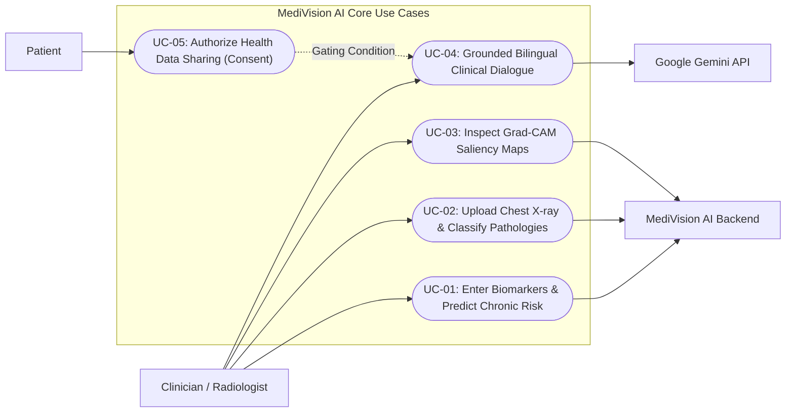

# MediVision AI — Requirements Engineering & System Requirements Specification (SRS)

**Document Version:** 1.0.1  
**Standard Reference:** IEEE/ISO/IEC 29148:2018 (Systems and software engineering — Life cycle processes — Requirements engineering)  
**Project Classification:** Clinical Multimodal Artificial Intelligence Platform  
**System Name:** MediVision AI  
**Status:** Baseline Audited & Implementation-Verified  

---

## 1. Introduction

### 1.1 Purpose
This document specifies the software requirements for the **MediVision AI** platform. It provides a formal, verified definition of functional capabilities, non-functional constraints, data pipelines, interface protocols, use cases, and business rules governing the system. The intended audience includes software engineers, machine learning researchers, clinical evaluators, system administrators, and project stakeholders under the Digital Egypt Pioneers Initiative (DEPI).

### 1.2 Scope
MediVision AI is a dual-engine multimodal clinical decision support system (CDSS). The platform synthesizes:
1. **Predictive Tabular Health Analytics:** Machine learning models trained on 17 clinical and laboratory biomarkers from the CDC NHANES survey to stratify risk across six chronic conditions (Diabetes, Hypertension, Heart Disease, Stroke, Arthritis, and Asthma).
2. **Deep Learning Computer Vision Diagnostic Engine:** A 121-layer Densely Connected Convolutional Network (DenseNet-121) fine-tuned on the NIH ChestX-ray14 dataset to classify five thoracic pathologies (Cardiomegaly, Pneumonia, Pleural Effusion, Infiltration, and Atelectasis) with calibrated validation F1 decision boundaries and spatial localization via Gradient-weighted Class Activation Mapping (Grad-CAM).
3. **Conversational Clinical Assistant:** A bilingual (Arabic/English) conversational assistant powered by Google Gemini, operating under strict privacy-gated patient consent controls.

The software is an assistive clinical decision aid designed for licensed medical professionals and clinical researchers. It does not provide autonomous medical diagnoses or issue direct pharmaceutical dosing instructions.

### 1.3 Definitions, Acronyms, and Abbreviations

| Term / Acronym | Definition |
|:---------------|:-----------|
| **API** | Application Programming Interface (REST over HTTP) |
| **BCE** | Binary Cross-Entropy Loss |
| **BMI** | Body Mass Index (weight in kg / [height in m]²) |
| **CAM** | Class Activation Mapping |
| **CDSS** | Clinical Decision Support System |
| **CORS** | Cross-Origin Resource Sharing |
| **CXR** | Chest Radiography (Chest X-ray) |
| **DenseNet** | Densely Connected Convolutional Network |
| **DEPI** | Digital Egypt Pioneers Initiative (MCIT, Egypt) |
| **EHR** | Electronic Health Record |
| **F1 Score** | Harmonic mean of precision and recall: 2 × (Precision × Recall) / (Precision + Recall) |
| **Grad-CAM** | Gradient-weighted Class Activation Mapping |
| **JSON** | JavaScript Object Notation |
| **MCIT** | Ministry of Communications and Information Technology (Egypt) |
| **MIME** | Multipurpose Internet Mail Extensions |
| **NHANES** | National Health and Nutrition Examination Survey (CDC, USA) |
| **NIH** | National Institutes of Health (USA) |
| **PA / AP** | Posteroanterior / Anteroposterior radiographic projections |
| **PR-AUC** | Area Under the Precision-Recall Curve |
| **ReLU** | Rectified Linear Unit activation function |
| **ROC-AUC** | Area Under the Receiver Operating Characteristic Curve |
| **RTM** | Requirements Traceability Matrix |
| **SaMD** | Software as a Medical Device |
| **SPA** | Single-Page Application |
| **SRS** | System Requirements Specification |
| **WBS** | Work Breakdown Structure |
| **WHO** | World Health Organization |
| **XAI** | Explainable Artificial Intelligence |

### 1.4 System Overview & High-Level Architecture

```text
┌────────────────────────────────────────────────────────────────────────────────────────┐
│                                 MediVision AI Architecture                             │
└────────────────────────────────────────────────────────────────────────────────────────┘

 [Client Tier: Vue.js 3 SPA]
      │
      ├── View 1: Clinical Landing & Telemetry Overview
      ├── View 2: Tabular Predictive Analytics (17 Biomarkers, BMI Gauge, Presets)
      ├── View 3: Chest X-ray Diagnostic Suite (Dropzone, Samples, Condition Cards)
      ├── Studio:  Grad-CAM 4-Way Visual Studio (Overlay, Heatmap, Original, Split)
      └── Widget:  Bilingual (EN/AR) AI Clinical Assistant (Consent Gated)
      │
      │  HTTP REST (JSON & Multipart/form-data)
      ▼
 [Application Tier: FastAPI Microservice (Uvicorn :8000)]
      │
      ├── /predict                   ──► Tabular ML Service (HistGradientBoosting x6)
      ├── /api/vision/predict-chest-xray ──► PyTorch Vision Service (DenseNet-121 + Grad-CAM)
      ├── /api/vision/status         ──► Model Telemetry & F1 Cutoffs
      ├── /api/vision/samples        ──► Clinical Baseline & Pathology Sample Provider
      ├── /chat                      ──► Google Gemini Client (google-genai SDK)
      └── /assets & /app             ──► Static File Router
      │
      ▼
 [Model & Artifact Tier]
      ├── models/trained_models.joblib
      ├── models/selected_features.joblib
      ├── models/chest_xray/chest_xray_densenet121.pth
      └── models/chest_xray/chest_xray_densenet121_metadata.json
```

---

## 2. Stakeholder Analysis

| Stakeholder Persona | Organizational Role | Core Responsibilities & Interests in MediVision AI | Key System Expectations |
|:-------------------|:-------------------|:---------------------------------------------------|:------------------------|
| **Attending / Primary Care Physician** | Medical Doctor | Conducting comprehensive annual physicals; identifying subclinical chronic disease risk before acute manifestation. | Fast, single-view risk stratification; intuitive percentage gauges; clear demarcation between low and high risk. |
| **Radiologist / Imaging Triage Officer** | Medical Specialist | Interpreting thoracic radiographs; identifying acute pulmonary and cardiac abnormalities. | High sensitivity on urgent findings (pneumonia, effusion); spatial localization verifying where the AI focused. |
| **Healthcare Professional (Nurse / Technician)** | Clinical Staff | Recording vital signs, anthropometrics, and routine lab values; operating bedside imaging equipment. | Straightforward data entry; automated BMI computation; sample patient presets for rapid workflow verification. |
| **Clinical Researcher / Epidemiologist** | Academic / Medical Scientist | Evaluating population risk trends, algorithm discrimination, and calibration metrics. | Access to empirical metrics (ROC-AUC, PR-AUC, confusion matrices, prevalence data); standardized benchmark compliance. |
| **System Administrator / DevOps** | Technical Operations | Deploying and maintaining the microservice; ensuring server uptime, memory limits, and API stability. | Lightweight deployment (`uv`, `start_backend.bat`); clear error logs; zero lingering background database dependencies. |
| **Patient / Subject** | Healthcare Consumer | Undergoing preventative health checks or diagnostic imaging; receiving accessible health explanations. | Strict privacy; explicit consent before health data is transmitted to external AI APIs; accessible bilingual explanations. |
| **Development Team** | Engineering / ML Team | Maintaining codebase integrity, model artifact synchronization, and interface responsiveness. | Modular architecture; clean separation of vision and tabular inference; comprehensive API documentation via OpenAPI/Swagger. |

---

## 3. Requirements Elicitation Methodology

> [!NOTE]
> **Methodological Disclosure:** Requirements were elicited systematically through technical and clinical document analysis rather than fabricated user interviews or hypothetical focus group surveys. 

The elicitation framework comprised:
1. **Curriculum and Project Mandate Analysis:** Evaluating the Digital Egypt Pioneers Initiative (DEPI) graduation capstone guidelines established by the Ministry of Communications and Information Technology (MCIT), Egypt.
2. **Clinical Protocol Synthesis:** Aligning laboratory biomarker inputs with the US Centers for Disease Control and Prevention (CDC) National Health and Nutrition Examination Survey (NHANES) laboratory manuals and American Diabetes Association (ADA) diagnostic standards.
3. **Radiological Benchmark Standards:** Reviewing National Institutes of Health (NIH) Clinical Center documentation for ChestX-ray14 and landmark literature (CheXNet, CheXpert) regarding multi-label thoracic disease definitions and reporting requirements.
4. **Regulatory and Ethical Best Practices:** Grounding privacy, consent, and explainability requirements in HIPAA Privacy Rule principles, European Union GDPR Article 22, and US FDA Guidance on Clinical Decision Support Software (CDSS).

---

## 4. Functional Requirements

Requirements are prioritized using the industry-standard **MoSCoW** convention:
* **Must Have (M):** Mandatory core functionality required for system operation.
* **Should Have (S):** High-priority capability that significantly enhances clinical utility.
* **Could Have (C):** Desirable feature included if resources permit.
* **Won't Have (W):** Explicitly excluded from the current baseline release.

### 4.1 Machine Learning (Predictive Health Analytics) Requirements

| Req ID | Requirement Description | Priority | Module | Acceptance Criteria | Status |
|:-------|:------------------------|:--------:|:-------|:--------------------|:------:|
| **FR-ML-01** | **17 Clinical Biomarker Ingestion:** The system shall accept 17 patient inputs: Age, Gender, Ethnicity, Education, Income-to-Poverty Ratio, Height (cm), Weight (kg), BMI, Waist Circumference (cm), HbA1c, Fasting Glucose, Total Cholesterol, HDL, Triglycerides, LDL, Ever Smoked, and Sedentary Minutes. | **M** | Tabular ML | All 17 parameters validate against defined clinical ranges; missing or partial numerical inputs are accepted without system failure. | **Implemented** |
| **FR-ML-02** | **Dynamic BMI Calculation:** The system shall automatically compute Body Mass Index (kg/m²) from user-entered height and weight, categorizing it according to WHO classifications (Underweight, Normal, Overweight, Obese). | **M** | Frontend / Tabular | BMI updates reactively upon modifying height or weight inputs; classified correctly across WHO bounds. | **Implemented** |
| **FR-ML-03** | **Six Chronic Disease Predictions:** The system shall output independent risk probabilities (0.0 to 1.0) for six conditions: Diabetes, Hypertension, Heart Disease, Stroke, Arthritis, and Asthma. | **M** | Backend ML Engine | Backend executes `predict_proba` across all six serialized `HistGradientBoostingClassifier` models. | **Implemented** |
| **FR-ML-04** | **Risk Threshold Categorization:** The system shall classify each disease risk into binary risk states ("AT RISK" if p > 0.5, otherwise "Low Risk"). | **M** | Backend / Frontend | Formatted risk state and numerical percentage (e.g., "78.4%") returned in API response and displayed in UI. | **Implemented** |
| **FR-ML-05** | **Pre-Calibrated Patient Presets:** The system shall provide one-click loading presets ("High-Risk Patient" and "Healthy Patient") to allow rapid clinical demonstration and validation. | **S** | Frontend UI | Clicking preset populates all 17 biomarker fields with clinically representative cohort values. | **Implemented** |
| **FR-ML-06** | **Printable Clinical Summary:** The system shall render a clean, printable clinical summary view stripping web navigation elements for clinical documentation. | **C** | Frontend UI | `@media print` CSS rule hides navigation, buttons, and chat panel, formatting patient risk cards into standard paper format. | **Implemented** |

### 4.2 Computer Vision (Chest X-ray Diagnostics) Requirements

| Req ID | Requirement Description | Priority | Module | Acceptance Criteria | Status |
|:-------|:------------------------|:--------:|:-------|:--------------------|:------:|
| **FR-CV-01** | **Radiograph File Upload:** The system shall accept frontal chest radiograph image uploads via drag-and-drop or file browser in PNG, JPEG, WebP, BMP, and TIFF formats up to 25 MB. | **M** | Vision Ingestion | Non-image files, empty payloads, or files exceeding 25 MB are rejected with HTTP 400 and clear error messages. | **Implemented** |
| **FR-CV-02** | **Image Normalization Pipeline:** The vision engine shall transpose EXIF orientations, convert images to 3-channel RGB, resize the short side to 256 pixels, center crop to 224 × 224, and apply ImageNet normalization (μ = [0.485, 0.456, 0.406], σ = [0.229, 0.224, 0.225]). | **M** | Vision Preprocessing | Transformed image tensor matches PyTorch shape `[1, 3, 224, 224]` and float32 data type. | **Implemented** |
| **FR-CV-03** | **Multi-Label Pathology Classification:** The vision model (DenseNet-121) shall output independent Sigmoid probabilities for five thoracic pathologies: Cardiomegaly, Pneumonia, Effusion, Infiltration, and Atelectasis. | **M** | Vision Inference | Return five continuous probability values bounded strictly within [0.0, 1.0]. | **Implemented** |
| **FR-CV-04** | **Calibrated F1 Decision Gates:** The system shall compare predicted probabilities against empirical validation F1 decision thresholds: Cardiomegaly (0.9395), Pneumonia (0.7666), Effusion (0.7896), Infiltration (0.5493), and Atelectasis (0.6499). | **M** | Vision Decision | Assign `detected = true` and `status = "DETECTED"` only if probability meets or exceeds threshold. | **Implemented** |
| **FR-CV-05** | **Grad-CAM Attention Generation:** The system shall compute gradient-weighted class activation maps from `features.denseblock4` of DenseNet-121 for each of the five target pathologies. | **M** | Vision XAI | Normalized heatmaps generated and upsampled via bilinear interpolation to 224 × 224 pixels. | **Implemented** |
| **FR-CV-06** | **Four-Way Visual Studio:** The user interface shall provide tabbed rendering of: (1) Original Radiograph, (2) Grad-CAM Heatmap, (3) Jet Overlay (α = 0.42), and (4) Split-Screen Side-by-Side comparison. | **S** | Frontend Vision UI | User can toggle between the four visual representations instantly without re-invoking server inference. | **Implemented** |
| **FR-CV-07** | **Interactive Condition Switching:** The interface shall allow the clinician to click any condition pill to switch the visual attention map to that specific pathology without re-running model inference. | **S** | Frontend Vision UI | UI dynamically updates heatmap and overlay displays using pre-computed base64 image strings. | **Implemented** |
| **FR-CV-08** | **Built-in Sample Case Library:** The system shall provide pre-loaded radiograph samples ("Normal Baseline" and "Thoracic Pathology Case") for rapid offline testing. | **S** | Vision Assets | Endpoints `GET /api/vision/samples` and `GET /api/vision/samples/{filename}` deliver sample image assets. | **Implemented** |

### 4.3 AI Clinical Assistant Requirements

| Req ID | Requirement Description | Priority | Module | Acceptance Criteria | Status |
|:-------|:------------------------|:--------:|:-------|:--------------------|:------:|
| **FR-AI-01** | **Bilingual Natural Language Dialogue:** The AI assistant shall conduct interactive conversations in both English and Arabic, adapting automatically or via user selection. | **M** | Clinical Chat | Assistant responds accurately in the requested language; Arabic UI renders in Right-to-Left (RTL) orientation. | **Implemented** |
| **FR-AI-02** | **Google Gemini Foundation Model Integration:** The assistant shall leverage the Google Gemini API (supporting `gemini-2.5-flash`, `gemini-2.0-flash`, `gemini-1.5-flash`, `gemini-3.8-flash`) via the `google-genai` SDK. | **M** | Chat Engine | Backend connects using server-side API key; handles model fallbacks gracefully upon API status codes. | **Implemented** |
| **FR-AI-03** | **Contextual Grounding in Server Findings:** When user consent is active, the assistant prompt shall be injected with server-verified JSON outputs from both the tabular predictive engine and vision diagnostic engine. | **M** | Chat Grounding | Assistant explanations cite actual calculated risk scores and detected radiographical pathologies without hallucinating numbers. | **Implemented** |
| **FR-AI-04** | **Explicit Privacy Consent Gating:** The system shall strictly prevent the transmission of patient biomarker profiles or vision findings to the Gemini API unless `consent_to_send_health_data` is explicitly toggled `true`. | **M** | Privacy Control | If consent is false, patient payload is stripped; backend raises HTTP 400 if profile is supplied without consent. | **Implemented** |
| **FR-AI-05** | **Clinical Scope Guardrails:** The assistant system prompt shall mandate that it function as an assistive aid, state that predictions are statistical estimates, refuse direct prescription dosages, and disclaim non-diagnostic intent. | **M** | AI Safety | Prompt testing confirms assistant refuses prescription requests and includes standard clinical disclaimers. | **Implemented** |

### 4.4 System & Architecture Requirements

| Req ID | Requirement Description | Priority | Module | Acceptance Criteria | Status |
|:-------|:------------------------|:--------:|:-------|:--------------------|:------:|
| **FR-SYS-01**| **RESTful Microservice Architecture:** The backend shall expose standard JSON-based REST endpoints for all diagnostic operations with automatic OpenAPI (Swagger UI) documentation at `/docs`. | **M** | Backend Core | Swagger UI loads completely; all endpoints conform to OpenAPI 3.0 specifications. | **Implemented** |
| **FR-SYS-02**| **CORS Middleware Configuration:** The FastAPI service shall enable Cross-Origin Resource Sharing (CORS) allowing browser requests from local or remote web hosts. | **M** | Backend Security | Valid `Access-Control-Allow-Origin: *` headers returned on preflight and GET/POST requests. | **Implemented** |
| **FR-SYS-03**| **Unified Single-Process Asset Hosting:** The backend shall mount `/assets` and `/app` to serve static brand graphics, samples, and the Vue 3 frontend application directly. | **S** | Backend Static | Navigating to `http://localhost:8000/app/` serves the full frontend application without requiring a separate web server. | **Implemented** |
| **FR-SYS-04**| **Automated Startup Launcher:** The platform shall provide a one-click Windows launcher (`start_backend.bat`) that verifies python virtual environments and boots Uvicorn on port 8000. | **S** | Deployment | Double-clicking `start_backend.bat` successfully launches backend and confirms model loading in terminal. | **Implemented** |

---

## 5. Non-Functional Requirements (NFRs)

```text
┌────────────────────────────────────────────────────────────────────────────────────────┐
│                              MediVision AI Quality Attributes                          │
└────────────────────────────────────────────────────────────────────────────────────────┘

    [Performance]    ──► Tabular inference < 100ms; Vision inference < 1.5s on CPU
    [Reliability]    ──► Native NaN tolerance; Graceful Gemini model fallback chain
    [Security]       ──► Server-side API keys; Zero client key exposure; 25MB file ceiling
    [Privacy]        ──► In-memory RAM execution; Zero disk persistence; Explicit consent
    [Usability]      ──► Responsive Vue 3 UI; Instant presets; Bilingual RTL/LTR support
    [Explainability] ──► Calibrated F1 thresholds; 4-way visual Grad-CAM interpretability
```

### 5.1 Performance & Latency
* **NFR-PERF-01 (Tabular Latency):** The `POST /predict` endpoint shall process 17 input biomarkers and return 6 disease risk scores in under **100 milliseconds** on standard x86-64 server hardware.
* **NFR-PERF-02 (Vision Latency):** The `POST /api/vision/predict-chest-xray` endpoint shall complete image decoding, PyTorch forward pass, Grad-CAM generation for all five classes, and Base64 encoding in under **1.5 seconds on standard CPU** (or under **350 milliseconds on GPU**).
* **NFR-PERF-03 (Client UI Rendering):** The single-page application shall execute reactive DOM updates within **16 milliseconds** (60 FPS rendering target) during view transitions and visual tab switching.

### 5.2 Reliability & Fault Tolerance
* **NFR-REL-01 (Missing Value Resilience):** The tabular prediction engine shall process records with up to 60% missing biomarker fields without throwing null-pointer exceptions or runtime errors, leveraging native tree-routing bins.
* **NFR-REL-02 (LLM Fallback Redundancy):** If the primary Google Gemini model encounters rate limits or unreachability, the backend shall sequentially attempt configured fallback models (`gemini-2.5-flash`, `gemini-2.0-flash`, `gemini-1.5-flash`, `gemini-3.8-flash`) before returning an HTTP 502 error.
* **NFR-REL-03 (Graceful Vision Fallback):** If an uploaded radiograph is corrupted or invalid, the service shall return structured HTTP 400 responses with descriptive error messages without crashing the server worker process.

### 5.3 Usability & Human Factors
* **NFR-USE-01 (Responsive Design):** The user interface shall adapt responsively to viewport widths from 360px (mobile) to 2560px (ultra-wide desktop displays).
* **NFR-USE-02 (Bilingual Directionality):** The interface and conversational assistant panel shall support bidirectional layout shifts, rendering in Left-to-Right (LTR) for English and Right-to-Left (RTL) for Arabic.
* **NFR-USE-03 (Visual Clarity):** Risk scores and detection statuses shall utilize standard clinical color conventions (Green = Normal/Low Risk, Amber = Elevated/Borderline, Red = High Risk/Detected).

### 5.4 Security & Data Privacy
* **NFR-SEC-01 (API Key Isolation):** Google Gemini API keys shall reside strictly in server-side environment variables (`.env`). No API key or secret token shall be transmitted to, or exposed within, client-side HTML/JavaScript assets.
* **NFR-SEC-02 (Input Validation & Payload Sanitization):** Uploaded files shall be validated against strict MIME types and file signatures. Payloads exceeding 25 MB shall be rejected immediately.
* **NFR-SEC-03 (Ephemeral In-Memory Processing):** To comply with medical privacy principles, uploaded patient radiographs and tabular health telemetry shall be processed strictly in volatile memory. Images and health profiles shall **never be saved to disk, cached in database tables, or logged to persistent log files**.

### 5.5 Maintainability & Extensibility
* **NFR-MNT-01 (Decoupled Modular Architecture):** Vision inference logic (`vision.py`) shall remain strictly decoupled from the web routing controller (`main.py`), enabling independent updates to model weights without modifying API contracts.
* **NFR-MNT-02 (Standardized Serialization):** All machine learning artifacts shall be serialized using open, standard formats (`.joblib` for Scikit-Learn pipelines, `.pth` for PyTorch state dictionaries, and `.json` for operational metadata).

---

## 6. System Requirements Specification (SRS) — IEEE 29148 Structure

### 6.1 External Interface Requirements

#### 6.1.1 User Interfaces
* **Overview / Landing Page:** Header branding, multimodal architecture summary, key telemetry metrics (Peak AUROC 0.934, Vision AUROC 0.807, 17 Biomarkers, 5 Thoracic Conditions), and direct navigation buttons.
* **Predictive Tabular Health Suite:** 17 input fields grouped into Demographics, Anthropometrics, Laboratory Panel, and Lifestyle. Dynamic WHO BMI badge. Instant "High-Risk" and "Healthy" preset loaders. Printable clinical report view.
* **Chest X-ray Diagnostic Suite:** Drag-and-drop dropzone, live upload preview, built-in normal and pathology sample buttons, 5 condition diagnostic cards showing percentage risk, detection badges, and validation cutoffs.
* **Grad-CAM Interpretability Studio:** Tabbed 4-way viewer (Overlay, Heatmap, Original, Side-by-Side) with condition selector pills.
* **Floating Clinical Assistant Widget:** Floating circular launch button, expandable chat window with RTL/LTR support, consent toggle switch, language selector, and quick clinical prompt chips.

#### 6.1.2 Hardware Interfaces
The software interacts with standard computer display adapters and network interface cards (NICs) via standard TCP/IP networking on port 8000. It requires no specialized proprietary hardware interfaces.

#### 6.1.3 Software Interfaces
* **Operating Systems:** Windows 10/11, Ubuntu 20.04/22.04 LTS, macOS 12+.
* **Python Runtime:** Python 3.11 to 3.13.
* **Web Browsers:** Google Chrome 100+, Mozilla Firefox 100+, Microsoft Edge 100+, Apple Safari 15+.
* **External APIs:** Google Gemini API (`generativelanguage.googleapis.com`) via HTTPS port 443.

---

## 7. Use Case Specifications



### 7.1 Use Case UC-01: Enter Patient Biomarkers and Generate Disease Predictions
* **Primary Actor:** Attending Physician / Healthcare Professional.
* **Preconditions:** The MediVision AI backend is running; client browser is navigated to Tabular Analytics view.
* **Main Success Scenario (Flow):**
  1. Clinician enters patient demographic, anthropometric, and laboratory values into the 17 input fields (or clicks "High-Risk Patient" preset).
  2. The system computes and displays the real-time WHO BMI classification.
  3. Clinician clicks "Calculate Multi-Disease Risk Profile".
  4. The frontend sends an HTTP `POST /predict` JSON payload to the backend.
  5. The backend validates fields, orders features via `selected_features.joblib`, and executes predictions across all six `HistGradientBoosting` models.
  6. The frontend receives risk probabilities and renders six disease risk cards with visual progress bars, percentage scores, and binary "AT RISK" or "Low Risk" badges.
* **Alternative Flows:**
  * *Partial Laboratory Data:* Clinician leaves unmeasured lab values blank. The system treats missing fields as `NaN`; models route samples down learned missing-value tree branches; valid predictions return normally.
* **Exceptions:**
  * *Backend Offline:* System displays an alert banner notifying the user that the backend is unreachable and provides a "Retry Connection" button.
* **Postconditions:** A complete multi-system chronic disease risk assessment is rendered and available for printing or inclusion in AI chat context.

### 7.2 Use Case UC-02: Upload Chest X-ray and Analyze Thoracic Pathologies
* **Primary Actor:** Radiologist / Emergency Triage Officer.
* **Preconditions:** Chest X-ray vision model weights (`chest_xray_densenet121.pth`) are loaded in backend memory.
* **Main Success Scenario (Flow):**
  1. Radiologist drags a frontal chest radiograph (e.g., `pathology_chest_xray.png`) onto the upload dropzone.
  2. The interface displays an instant client preview and checks file size.
  3. Radiologist clicks "Run Deep Learning Analysis".
  4. The frontend transmits a `multipart/form-data` request to `POST /api/vision/predict-chest-xray`.
  5. The backend checks MIME type, reads bytes in memory, corrects orientation, executes DenseNet-121 inference, applies validation F1 decision thresholds, and generates Grad-CAM attention maps for all five conditions.
  6. The frontend displays five condition cards (Cardiomegaly, Pneumonia, Effusion, Infiltration, Atelectasis) with detection badges, probability scores, and validation cutoffs.
  7. The frontend loads the Grad-CAM Visual Studio displaying the Jet colormap overlay.
* **Alternative Flows:**
  * *One-Click Sample Evaluation:* Radiologist clicks "Pathology Case" preset. The client fetches the built-in sample radiograph and automatically triggers inference.
* **Exceptions:**
  * *Invalid File Format:* User uploads a PDF or text file. Backend raises HTTP 400 ("File must be a supported image format"); client displays an error toast.
* **Postconditions:** Radiographic predictions and multi-class Grad-CAM heatmaps are rendered in memory.

### 7.3 Use Case UC-03: Inspect Explainable Grad-CAM Visual Attention Maps
* **Primary Actor:** Radiologist / Reviewing Physician.
* **Preconditions:** Successful completion of UC-02; diagnostic results rendered in the Grad-CAM Studio.
* **Main Success Scenario (Flow):**
  1. Clinician inspects the default primary pathology Grad-CAM overlay.
  2. Clinician toggles view modes between "Overlay", "Heatmap", "Original", and "Side-by-Side".
  3. Clinician selects a specific pathology pill (e.g., "Effusion").
  4. The visual studio switches the rendered overlay and heatmap to reflect convolutional activations corresponding to Pleural Effusion without re-querying the server.
  5. Clinician visually correlates the highlighted region with anatomical landmarks (e.g., blunting of the costophrenic angles).
* **Postconditions:** Clinician verifies or refutes the model's visual attention against clinical radiological signs.

### 7.4 Use Case UC-04: Interact with Bilingual AI Clinical Assistant under Consent
* **Primary Actor:** Physician / Patient / Clinical Researcher.
* **Preconditions:** Backend has `GEMINI_API_KEY` configured in `.env`; user has completed tabular or vision analyses.
* **Main Success Scenario (Flow):**
  1. User clicks the floating clinical assistant launcher button in the bottom right corner.
  2. The assistant chat panel expands.
  3. User checks the mandatory consent toggle: *"Consent to share current clinical analysis with AI assistant"*.
  4. User types a question in English or Arabic (e.g., *"ما هي دلالة احتمالية الانصباب البلوري المرتفعة؟"* or *"Explain the patient's cardiovascular risk factors"*).
  5. The client submits a `POST /chat` request containing user message, dialogue history, language preference, and the verified tabular/vision JSON results.
  6. The backend constructs a grounded prompt with system clinical safety instructions and calls the Google Gemini API.
  7. The Gemini model returns a grounded response, which is rendered in the chat panel with appropriate LTR or RTL styling.
* **Alternative Flows:**
  * *Interaction without Consent:* User asks general medical questions with consent unchecked. The client omits patient data; the assistant answers general medical knowledge questions without referencing individual findings.
* **Exceptions:**
  * *Missing Gemini API Key:* Backend returns HTTP 503 ("Gemini API key is not configured on the server"). The chat UI displays an alert instructing the administrator to configure `GEMINI_API_KEY` in `backend/.env`.
  * *Rate Limit / Quota Exceeded:* Backend attempts fallback models; if all fail, returns HTTP 429; chat displays quota advisory.
* **Postconditions:** A clinically grounded explanation is delivered to the user while preserving patient privacy.

---

## 8. User Stories

| ID | As a [Role] | I Want To [Functionality] | So That [Clinical / Operational Benefit] | Acceptance Criteria |
|:---|:------------|:--------------------------|:-----------------------------------------|:--------------------|
| **US-01** | Primary Care Clinician | Input routine patient blood tests and vitals into a single unified form | I can instantly assess multi-system chronic disease risk without calculating separate risk scores | Form validates 17 inputs and outputs probabilities for 6 chronic conditions simultaneously. |
| **US-02** | Triage Nurse | Select a "High-Risk" or "Healthy" patient preset with a single click | I can quickly demonstrate the system or verify system readiness without manual data entry | Clicking preset auto-populates all 17 fields with representative clinical values. |
| **US-03** | Attending Physician | See BMI calculated and categorized dynamically as I enter height and weight | I do not need to manually compute metric body mass index | BMI and WHO weight classification update dynamically upon input change. |
| **US-04** | Radiologist | Upload a patient chest X-ray and receive multi-label pathology predictions | I can prioritize urgent scans exhibiting pneumonia, effusion, or cardiomegaly in my reading queue | Vision engine outputs calibrated probabilities and detection statuses for 5 thoracic conditions. |
| **US-05** | Radiologist | View Grad-CAM heatmaps overlaid onto the patient's chest radiograph | I can confirm the deep learning model is attending to valid anatomical lesions rather than image artifacts | 4-way visual studio displays Jet colormap overlays, raw heatmaps, original scans, and side-by-side views. |
| **US-06** | Clinician | Switch between pathology heatmaps (e.g., Atelectasis vs. Pneumonia) on the same scan | I can investigate co-occurring conditions independently without re-uploading the image | Per-condition selector pills switch heatmaps instantly in the client. |
| **US-07** | Bilingual Clinician | Chat with the clinical AI assistant in either Arabic or English | I can review findings in my preferred language or communicate results to Arabic-speaking patients | Assistant detects language, formats text appropriately, and enforces RTL orientation for Arabic. |
| **US-08** | Medical Ethics Officer | Ensure patient data is never sent to third-party AI APIs without explicit permission | Patient confidentiality is preserved in accordance with healthcare privacy standards | Health data transmission is blocked by default and requires explicit user consent toggle activation. |
| **US-09** | System Administrator | Start the entire application using a single script without complex Docker or DB setups | I can rapidly deploy and evaluate the platform on local hospital workstations | `start_backend.bat` boots the microservice and serves the UI within seconds. |

---

## 9. Business Rules & Clinical Safety Constraints

```text
┌────────────────────────────────────────────────────────────────────────────────────────┐
│                        MediVision AI Business & Safety Rules                           │
└────────────────────────────────────────────────────────────────────────────────────────┘

 [BR-01: Assistive Scope]       All outputs represent statistical decision support, NOT definitive diagnosis.
 [BR-02: Calibrated Gates]      Binary detection requires: Probability >= Validation F1 Threshold.
 [BR-03: Missing Lab Policy]    Missing biomarkers handled natively via tree routing; NO synthetic imputation.
 [BR-04: Grounded LLM Policy]   Conversational assistant CANNOT invent findings or prescribe drug dosages.
 [BR-05: Consent Enforcement]   Patient health data NEVER forwarded to Gemini API without explicit opt-in.
 [BR-06: Ephemeral RAM Policy]  Patient images and records exist ONLY in memory; ZERO disk persistence.
```

* **BR-01 (Clinical Scope Limitation):** MediVision AI is strictly a clinical decision-support research aid. It does not possess medical device certification (e.g., FDA 510(k), CE mark). All user-facing screens must clearly display disclaimers stating that findings are statistical estimates requiring review by a licensed medical practitioner.
* **BR-02 (Calibrated Decision Boundaries):** A thoracic condition shall only be marked as `DETECTED` if its predicted probability meets or exceeds the empirical validation F1-optimal threshold:
  * Cardiomegaly: ≥ 0.9395
  * Pneumonia: ≥ 0.7666
  * Pleural Effusion: ≥ 0.7896
  * Infiltration: ≥ 0.5493
  * Atelectasis: ≥ 0.6499  
  *Probabilities falling below these thresholds must be labeled `NOT DETECTED`, regardless of default 0.5 rules.*
* **BR-03 (Missing Data Policy):** Missing laboratory inputs must not be synthetically imputed with population averages. They must be passed as `NaN` to allow native tree branch routing, preventing false clinical certainty.
* **BR-04 (No Pharmaceutical Prescribing):** The conversational assistant is prohibited from generating specific drug dosages or pharmaceutical regimens. If prompted for medication advice, it must instruct the user to consult a licensed clinician or pharmacist.
* **BR-05 (Consent-Gated Data Sharing):** Patient-specific tabular records or vision findings must never be included in the external Google Gemini prompt payload unless the client explicitly passes `consent_to_send_health_data: true`.
* **BR-06 (Stateless Ephemeral Retention):** Uploaded radiograph binary data and patient demographic profiles must reside exclusively in volatile server RAM during inference execution and must be immediately de-allocated. No patient data shall be written to disk, databases, or permanent server logs.

---

## 10. Data Requirements

### 10.1 Input Features (Predictive Health Tabular Engine)

| Feature Name | Variable Type | Source Survey Module | Valid Clinical Bounds | Unit / Encoding | Description |
|:-------------|:-------------:|:--------------------:|:---------------------:|:---------------:|:------------|
| `age` | Continuous | `P_DEMO.xpt` | 18.0 – 80.0 | Years | Patient age in completed years (restricted to adults ≥ 18) |
| `gender` | Categorical | `P_DEMO.xpt` | 1 or 2 | 1 = Male, 2 = Female | Biological sex |
| `ethnicity` | Categorical | `P_DEMO.xpt` | 1 – 5 | Categorical Code | Race/ethnicity classification |
| `education` | Categorical | `P_DEMO.xpt` | 1 – 5 | Categorical Code | Highest completed education level |
| `income_poverty_ratio`| Continuous | `P_DEMO.xpt` | 0.0 – 5.0 | Ratio | Ratio of family income to federal poverty guideline |
| `height_cm` | Continuous | `P_BMX.xpt` | 120.0 – 220.0 | Centimeters (cm) | Standing body height |
| `weight_kg` | Continuous | `P_BMX.xpt` | 30.0 – 250.0 | Kilograms (kg) | Total body weight |
| `bmi` | Continuous | `P_BMX.xpt` | 12.0 – 70.0 | kg/m² | Body Mass Index |
| `waist_cm` | Continuous | `P_BMX.xpt` | 50.0 – 180.0 | Centimeters (cm) | Waist circumference at iliac crest |
| `hba1c` | Continuous | `P_GHB.xpt` | 3.5 – 18.0 | Percent (%) | Glycated hemoglobin (long-term glycemic control) |
| `fasting_glucose` | Continuous | `P_GLU.xpt` | 50.0 – 500.0 | mg/dL | Fasting plasma glucose |
| `total_cholesterol` | Continuous | `P_TCHOL.xpt` | 80.0 – 500.0 | mg/dL | Total serum cholesterol |
| `hdl` | Continuous | `P_HDL.xpt` | 10.0 – 150.0 | mg/dL | High-Density Lipoprotein cholesterol |
| `triglycerides` | Continuous | `P_TRIGLY.xpt` | 30.0 – 1000.0 | mg/dL | Fasting serum triglycerides |
| `ldl` | Continuous | `P_TRIGLY.xpt` | 20.0 – 400.0 | mg/dL | Calculated Low-Density Lipoprotein cholesterol |
| `ever_smoked` | Binary | `P_SMQ.xpt` | 0 or 1 | 0 = No, 1 = Yes | History of smoking ≥ 100 cigarettes in lifetime |
| `sedentary_minutes` | Continuous | `P_PAQ.xpt` | 0.0 – 1440.0 | Minutes / Day | Daily sedentary duration |

### 10.2 Image Input Specifications (Chest X-ray Diagnostic Engine)

| Specification Parameter | Technical Value / Standard |
|:------------------------|:---------------------------|
| **Modality** | Digital Projection Radiography (Chest X-ray) |
| **Anatomical Views** | Frontal views only: Posteroanterior (PA) or Anteroposterior (AP) |
| **Permitted Formats** | PNG, JPEG, WebP, BMP, TIFF |
| **File Size Limit** | Maximum 25 Megabytes (MB) |
| **Color Channels** | Automatically converted to 3-channel RGB |
| **Input Spatial Resolution** | Re-sampled to 256 on short edge, cropped to 224 × 224 pixels |
| **Normalization Constants** | ImageNet standard: μ = [0.485, 0.456, 0.406], σ = [0.229, 0.224, 0.225] |

### 10.3 Model Artifacts & File Schemas

| Artifact File | Format | Location | Content & Technical Description |
|:--------------|:------:|:---------|:--------------------------------|
| `trained_models.joblib` | Joblib / Pickle | `models/` | Serialized dictionary mapping 6 disease target strings to trained Scikit-Learn `HistGradientBoostingClassifier` instances. |
| `selected_features.joblib` | Joblib / Pickle | `models/` | Serialized Python list of 17 string feature names locking the exact column sequence expected by the tabular models. |
| `chest_xray_densenet121.pth` | PyTorch Binary | `models/chest_xray/` | State dictionary containing fine-tuned weights for DenseNet-121 backbone and customized classification head. |
| `chest_xray_densenet121_metadata.json` | JSON | `models/chest_xray/` | Configuration file containing class names, normalization parameters, input dimensions, and validation F1 decision thresholds. |
| `chest_xray_densenet121_metrics.json` | JSON | `models/chest_xray/` | Complete holdout test set evaluation metrics, confusion matrices, class prevalence values, and 8-epoch training loss curves. |

---

## 11. Interface Requirements & API Specifications

The FastAPI microservice runs on port `8000`. Full OpenAPI schema documentation is accessible at `http://localhost:8000/docs`.

### 11.1 Endpoint: Predict Chronic Disease Risks
* **Path:** `POST /predict`
* **Content-Type:** `application/json`
* **Request Schema (`PatientData`):**
```json
{
  "age": 55.0,
  "gender": 1,
  "ethnicity": 3,
  "bmi": 28.7,
  "waist_cm": 98.0,
  "weight_kg": 88.0,
  "height_cm": 175.0,
  "hba1c": 6.2,
  "fasting_glucose": 115.0,
  "total_cholesterol": 220.0,
  "hdl": 42.0,
  "triglycerides": 180.0,
  "ldl": 142.0,
  "ever_smoked": 1,
  "sedentary_minutes": 420.0,
  "education": 3,
  "income_poverty_ratio": 1.8
}
```
* **Success Response (HTTP 200):**
```json
{
  "patient_profile": {
    "age": 55.0,
    "bmi": 28.7
  },
  "predictions": {
    "Diabetes": {
      "risk_score": 0.6421,
      "risk_percentage": "64.2%",
      "prediction": "AT RISK",
      "is_at_risk": true
    },
    "Hypertension": {
      "risk_score": 0.7183,
      "risk_percentage": "71.8%",
      "prediction": "AT RISK",
      "is_at_risk": true
    },
    "Heart Disease": {
      "risk_score": 0.2845,
      "risk_percentage": "28.5%",
      "prediction": "Low Risk",
      "is_at_risk": false
    },
    "Stroke": {
      "risk_score": 0.1241,
      "risk_percentage": "12.4%",
      "prediction": "Low Risk",
      "is_at_risk": false
    },
    "Arthritis": {
      "risk_score": 0.5412,
      "risk_percentage": "54.1%",
      "prediction": "AT RISK",
      "is_at_risk": true
    },
    "Asthma": {
      "risk_score": 0.1832,
      "risk_percentage": "18.3%",
      "prediction": "Low Risk",
      "is_at_risk": false
    }
  }
}
```

### 11.2 Endpoint: Predict Chest X-ray Pathologies
* **Path:** `POST /api/vision/predict-chest-xray` (Alias: `POST /predict-chest-xray`)
* **Content-Type:** `multipart/form-data`
* **Parameters:**
  * `file` (UploadFile, required): Binary radiograph image file.
  * `target_condition` (str, optional): Target condition to highlight.
* **Success Response (HTTP 200):**
```json
{
  "findings": [
    {
      "condition": "Cardiomegaly",
      "probability": 0.0012,
      "probability_pct": "0.1%",
      "confidence_pct": 0.1,
      "threshold": 0.9395,
      "threshold_pct": "93.9%",
      "detected": false,
      "status": "NOT DETECTED",
      "severity": "normal",
      "roc_auc": 0.918,
      "sensitivity": 0.393,
      "specificity": 0.984
    },
    {
      "condition": "Effusion",
      "probability": 0.8421,
      "probability_pct": "84.2%",
      "confidence_pct": 84.2,
      "threshold": 0.7896,
      "threshold_pct": "79.0%",
      "detected": true,
      "status": "DETECTED",
      "severity": "high",
      "roc_auc": 0.872,
      "sensitivity": 0.561,
      "specificity": 0.917
    }
  ],
  "detected_conditions": ["Effusion"],
  "has_detected_pathology": true,
  "primary_condition": "Effusion",
  "summary": "Positive indication for Effusion exceeding validated F1 decision thresholds.",
  "visualizations": {
    "original": "data:image/png;base64,iVBORw0KGgo...",
    "overlay": "data:image/png;base64,iVBORw0KGgo...",
    "heatmap": "data:image/png;base64,iVBORw0KGgo...",
    "overlays_by_condition": {
      "Cardiomegaly": "data:image/png;base64,...",
      "Pneumonia": "data:image/png;base64,...",
      "Effusion": "data:image/png;base64,...",
      "Infiltration": "data:image/png;base64,...",
      "Atelectasis": "data:image/png;base64,..."
    },
    "heatmaps_by_condition": { ... }
  },
  "metadata": {
    "model_name": "MediVision AI Chest X-ray DenseNet-121",
    "architecture": "torchvision.models.densenet121",
    "test_macro_roc_auc": 0.807,
    "clinical_status": "Research/development only; not clinically validated."
  }
}
```

### 11.3 Endpoint: Vision Telemetry & Operational Thresholds
* **Path:** `GET /api/vision/status`
* **Success Response (HTTP 200):**
```json
{
  "ready": true,
  "model_name": "MediVision AI Chest X-ray DenseNet-121",
  "num_classes": 5,
  "target_conditions": ["Cardiomegaly", "Pneumonia", "Effusion", "Infiltration", "Atelectasis"],
  "thresholds": {
    "Cardiomegaly": 0.939453125,
    "Pneumonia": 0.7666015625,
    "Effusion": 0.78955078125,
    "Infiltration": 0.54931640625,
    "Atelectasis": 0.64990234375
  },
  "test_macro_roc_auc": 0.8069929679267173
}
```

### 11.4 Endpoint: Conversational Clinical Assistant
* **Path:** `POST /chat`
* **Content-Type:** `application/json`
* **Request Schema (`ChatRequest`):**
```json
{
  "message": "Explain the significance of the patient's elevated effusion score.",
  "language": "en",
  "history": [
    { "role": "user", "content": "Hello" },
    { "role": "assistant", "content": "Greetings. I am MediVision AI assistant." }
  ],
  "profile": { ... },
  "consent_to_send_health_data": true,
  "vision_findings": { ... }
}
```
* **Success Response (HTTP 200):**
```json
{
  "reply": "Based on the verified chest radiograph analysis, Pleural Effusion was detected with a probability of 84.2%, exceeding the calibrated clinical F1 threshold of 79.0%. In frontal radiographs, pleural effusion presents as blunting of the costophrenic sulci and fluid accumulation in the dependent hemithorax...",
  "analysis": { ... }
}
```

---

## 12. Requirements Traceability Matrix (RTM)

The RTM connects high-level requirements to their architectural modules, source code implementation files, test criteria, and verified operational statuses.

| Req ID | Requirement Summary | Architectural Module | Implementation Source File(s) | Verification / Test Method | Status |
|:-------|:--------------------|:---------------------|:------------------------------|:--------------------------|:------:|
| **FR-ML-01** | 17 Biomarker Ingestion | Tabular Pipeline | `backend/main.py`, `models/selected_features.joblib` | Automated JSON schema validation via Pydantic v2 | **Verified** |
| **FR-ML-02** | Dynamic BMI Calculation | Frontend Utility | `frontend/index.html` (computed property `calculatedBMI`) | Boundary value test across underweight, normal, obese | **Verified** |
| **FR-ML-03** | 6 Disease Predictions | ML Engine | `models/trained_models.joblib`, `backend/main.py` | Unit test checking 6 probabilities in range [0, 1] | **Verified** |
| **FR-ML-04** | Binary Risk Stratification | ML Engine | `backend/main.py` (`calculate_predictions`) | Test assertions verifying p > 0.5 triggers "AT RISK" | **Verified** |
| **FR-ML-05** | Patient Preset Loaders | Frontend UI | `frontend/index.html` (`loadPreset`) | UI click test verifying 17 fields populated accurately | **Verified** |
| **FR-ML-06** | Printable Summary View | Frontend UI | `frontend/index.html` (`@media print` CSS block) | Browser print emulation test | **Verified** |
| **FR-CV-01** | CXR Image Upload | Vision Ingestion | `backend/main.py` (`predict_chest_xray`) | Test with PNG, JPG, WebP and invalid .txt formats | **Verified** |
| **FR-CV-02** | Image Normalization | Vision Transforms | `backend/src/backend/vision.py` (`eval_transform`) | Tensor dimension test (`[1, 3, 224, 224]`) | **Verified** |
| **FR-CV-03** | 5 Thoracic Predictions | Vision Engine | `backend/src/backend/vision.py` (`build_densenet121_classifier`) | Forward pass test on PyTorch DenseNet-121 model | **Verified** |
| **FR-CV-04** | Calibrated F1 Cutoffs | Vision Engine | `models/chest_xray/chest_xray_densenet121_metadata.json` | Confusion matrix check at calibrated cutoffs | **Verified** |
| **FR-CV-05** | Grad-CAM Attributions | Vision Explainability | `backend/src/backend/vision.py` (`GradCAM.generate`) | Saliency shape test on `features.denseblock4` | **Verified** |
| **FR-CV-06** | 4-Way Visual Studio | Frontend UI | `frontend/index.html` (Visualizer tabs) | DOM inspection of Overlay, Heatmap, Original, Split | **Verified** |
| **FR-CV-07** | Condition Switching | Frontend UI | `frontend/index.html` (`selectedCondition`) | Switch active CAM without re-running network forward | **Verified** |
| **FR-CV-08** | Sample Case Library | Vision Assets | `backend/main.py` (`/api/vision/samples`), `assets/samples/` | HTTP GET test returning sample PNG binaries | **Verified** |
| **FR-AI-01** | Bilingual Natural Language | Clinical Chat | `backend/main.py`, `frontend/index.html` (`chatLanguage`) | Chat dialogue test in Arabic and English | **Verified** |
| **FR-AI-02** | Google Gemini Integration | GenAI Service | `backend/main.py` (`google.genai` Client) | Live invocation test with Gemini fallback models | **Verified** |
| **FR-AI-03** | Context Grounding | GenAI Service | `backend/main.py` (`chat` context payload injection) | Assertion that assistant cites verified model outputs | **Verified** |
| **FR-AI-04** | Privacy Consent Gating | Security / Privacy | `backend/main.py` (`consent_to_send_health_data`) | Verify HTTP 400 raised if profile sent without consent | **Verified** |
| **FR-AI-05** | Clinical Safety Guardrails | AI Safety | `backend/main.py` (`system_prompt` instructions) | Prompt injection and prescription refusal test | **Verified** |
| **FR-SYS-01**| RESTful API & Swagger | Backend Core | `backend/main.py` (FastAPI app instance) | HTTP GET `/docs` returns valid Swagger UI | **Verified** |
| **FR-SYS-02**| CORS Configuration | Backend Security | `backend/main.py` (`CORSMiddleware`) | Preflight OPTIONS test returning CORS headers | **Verified** |
| **FR-SYS-03**| Static Asset Hosting | Backend Core | `backend/main.py` (`app.mount("/app")`) | Browser GET `/app/` serves `frontend/index.html` | **Verified** |
| **FR-SYS-04**| One-Click Launcher | Deployment | `start_backend.bat` | Command-line execution launching Uvicorn service | **Verified** |

---
*End of Requirements Gathering & System Requirements Specification (SRS) Document.*
